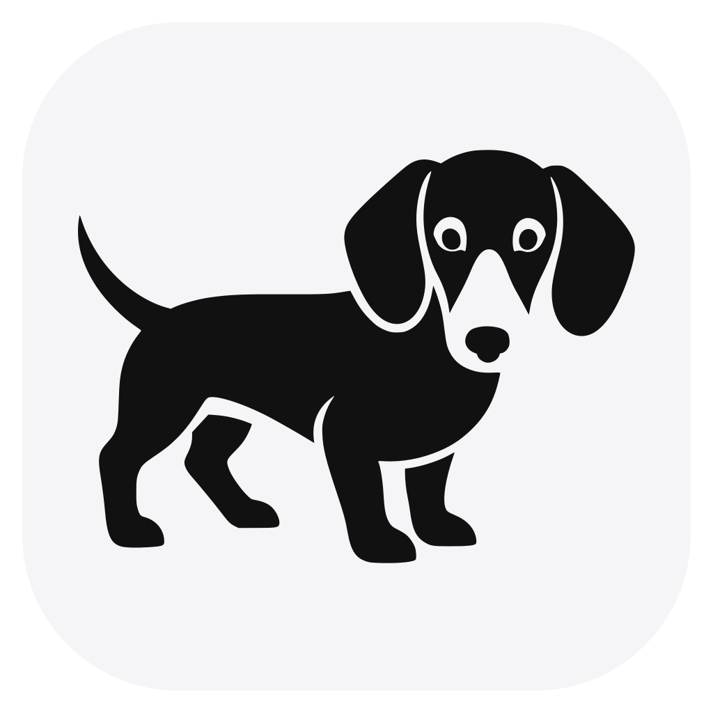
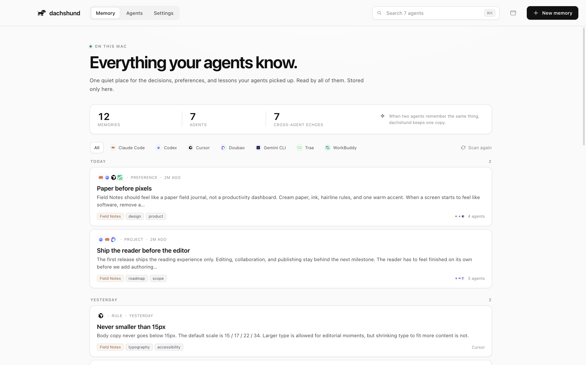
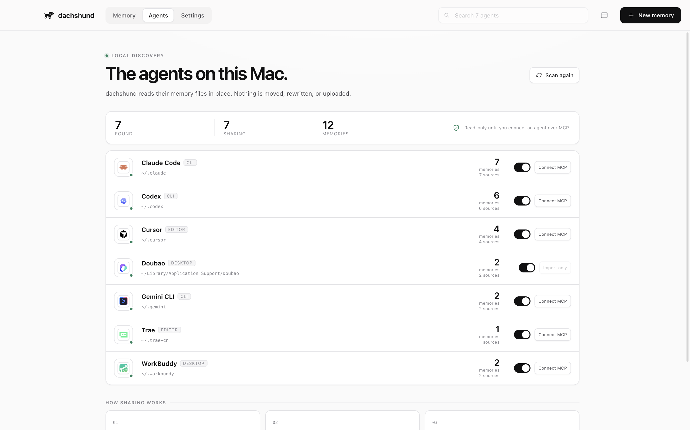
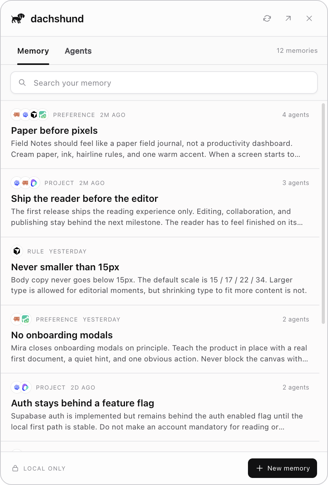

<div align="center">

<a href="https://github.com/Ewen2015/dachshund"></a>

# dachshund

### Every agent's memory. One local place.

**Claude Code remembers one decision. Codex remembers another. Cursor remembers the exception.**<br>
dachshund finds the memory files your agents already keep, brings them into one
Markdown library, and serves that library back through MCP. No account, no cloud,
no model requirement.

[](docs/MVP.md) [](LICENSE) [](#quick-start) [](#privacy)

**[Quick start](#quick-start)** &nbsp;·&nbsp; **[Supported agents](#supported-agents)** &nbsp;·&nbsp; **[How it works](#how-it-works)** &nbsp;·&nbsp; **[Docs](#documentation)** &nbsp;·&nbsp; **[Competitor research](docs/COMPETITORS.md)**

<br>



</div>

<br>

## Is dachshund for you?

Every agent keeps its own partial model of you. A project rule lives in Claude
Code. A failed approach lives in Codex. A typography preference lives in Cursor.
Switching tools means losing context or repeating yourself.

dachshund takes the memory that already exists and puts it behind one quiet
surface:

- **Discover what is already on your Mac.** Read known agent memory locations
  without rewriting the originals.
- **Keep one portable library.** Store the unified result as plain Markdown, with
  source provenance retained.
- **See cross-agent echoes.** When two agents remember the same thing, keep one
  memory and show every source.
- **Recall from any connected agent.** A loopback-only MCP bridge exposes search,
  context, remember, forget and stats tools.
- **Stay out of the way.** The whole utility lives in a compact macOS menu bar
  panel, with a full library window when you need it.

It is for you if you use more than one coding or desktop agent. If one agent
already remembers everything you need, you probably do not need dachshund.

## Quick start

**1 · Build.** Requirements: macOS on Apple Silicon, Node.js 22 or newer, and npm.

```sh
npm install
npm run build
npm start
```

**2 · Let it scan.** On first launch, dachshund detects the agents installed on
this Mac and imports their existing memory into:

```text
~/Documents/dachshund/memory/
```

**3 · Connect an agent.** Open **Agents**, turn on sharing for an installed
agent, then choose **Connect MCP**. dachshund writes only its own named MCP entry
and creates a backup before changing an existing config.

Build the Apple Silicon DMG:

```sh
npm run dist:mac
```

<sub>The current MVP is ad-hoc signed and not notarized. Gatekeeper may require a manual open. Production distribution still needs Developer ID signing and notarization.</sub>

## Supported agents

<table>
<tr><td>

Claude Code · Codex · Cursor · Gemini CLI · GitHub Copilot · OpenCode · Windsurf · Claude Desktop · WorkBuddy · Doubao · Trae

</td></tr>
</table>

dachshund shows only the agents found on your machine. Ten of the eleven
integrations currently have read-only importers. Claude Desktop is supported as
an MCP target. Doubao is import-only until a stable global MCP configuration path
is available.

See [Agent integrations](docs/AGENTS.md) for exact paths and formats, and
[Agent icons](docs/AGENT_ICONS.md) for brand asset provenance.

## How it works

```text
Claude Code  ─┐
Codex        ─┼─ read-only import ─→ ~/Documents/dachshund/memory/
Cursor       ─┤                         │
Other agents ─┘                         ├─→ SQLite FTS5 + BM25 index
                                        │
                                        └─→ 127.0.0.1 + bearer token
                                                   │
                                                   v
                                            MCP stdio bridge
                                                   │
                                        every connected agent
```

The Markdown files are the durable source of truth. SQLite is a rebuildable
index. The local HTTP service binds only to `127.0.0.1`, and the MCP bridge reads
its short-lived token from an owner-only runtime file.

See [Architecture](docs/ARCHITECTURE.md) for the process model, storage contract,
security boundary and failure modes.

## What it does

### Import first

Useful memory appears before you write anything. dachshund reads the formats
agents already produce, including Markdown, WorkBuddy notes, Trae session JSONL,
Codex memory files and readable Codex SQLite rows.

### One memory, visible echoes

Identical memory from multiple agents becomes one item with every source shown.
You can trace where it came from without turning the library into a collection of
duplicate notes.

### A real Mac utility

The tray icon, global shortcuts and 420 × 620 popover make the library ambient.
Use `Cmd+Shift+M` to minimize to the menu bar or `Cmd+Shift+D` to toggle the
compact panel.

<table>
<tr>
<td width="50%"></td>
<td width="50%"></td>
</tr>
</table>

### MCP without a cloud memory layer

Connected agents can:

- search shared memory;
- request a prompt-ready context block;
- write a durable memory;
- archive a shared memory;
- inspect library statistics.

| Tool | Purpose |
| :-- | :-- |
| `memory_search` | Find relevant memories with source agents |
| `memory_context` | Build a compact prompt-ready context block |
| `memory_remember` | Save a durable shared memory |
| `memory_forget` | Archive a shared copy without deleting the source |
| `memory_stats` | Show memories, agents, sources and echoes |

### Plain files, real identities

The library is readable and portable without dachshund. Agent logos are cached
from the pinned MIT-licensed LobeHub icon set at build time; the app makes no
remote icon requests at runtime.

## Privacy

- No user account and no hosted service.
- No analytics, telemetry or remote logging.
- No API key, LLM or embedding call on the core path.
- Agent-owned files are read in place and never rewritten by import.
- Archiving a shared memory does not delete the original agent file.
- The HTTP service is loopback-only and requires a random bearer token.

dachshund is local by architecture, not by configuration.

## Documentation

| | |
| :-- | :-- |
| **[Product](docs/PRODUCT.md)** | Product thesis, users, surfaces and boundaries |
| **[Design](docs/DESIGN.md)** | Visual system, layout, motion and accessibility |
| **[Architecture](docs/ARCHITECTURE.md)** | Processes, storage, MCP and security |
| **[Agent integrations](docs/AGENTS.md)** | Supported paths, formats and config writers |
| **[Agent icons](docs/AGENT_ICONS.md)** | Pinned icon sources and licensing |
| **[MVP](docs/MVP.md)** | Verification, checksums and known limitations |
| **[Development](docs/DEVELOPMENT.md)** | Data isolation, tests, screenshots and packaging |
| **[Competitor research](docs/COMPETITORS.md)** | Local-first memory landscape and product wedge |

## Development

```sh
npm run typecheck
npm run build
npm run test:mcp
npm run demo:seed
npm run screenshot
```

Tests and screenshots use isolated `DACHSHUND_HOME` and `DACHSHUND_LIBRARY`
directories. They never modify a real user agent configuration.

## Current limitations

- Deduplication is exact, not semantic.
- Library search is lexical, with no local embedding model.
- Imports run at startup and on explicit scans; there is no live file watcher.
- Source edits are not yet reconciled incrementally.
- The build is Apple Silicon only and not notarized.
- There is no cloud sync, team mode or multi-device history.

## License

[MIT](LICENSE)

dachshund is an independent project. Product names and logos belong to their
respective owners; Magpie is referenced only as a product-design inspiration.
