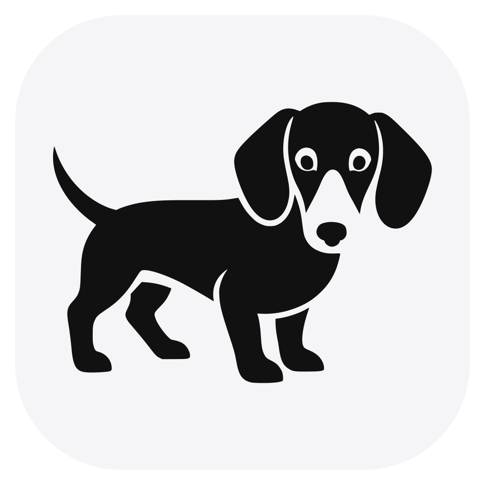
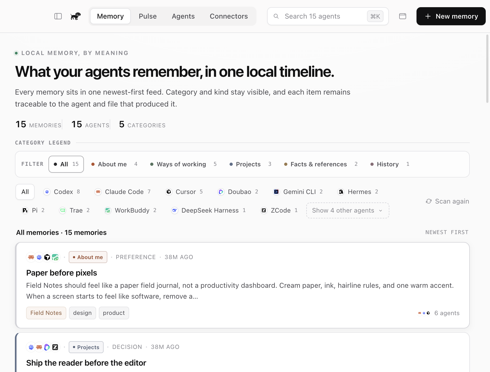
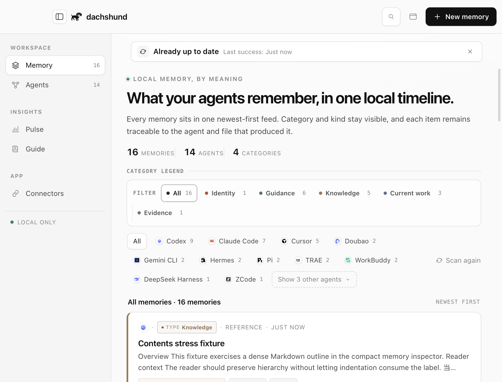
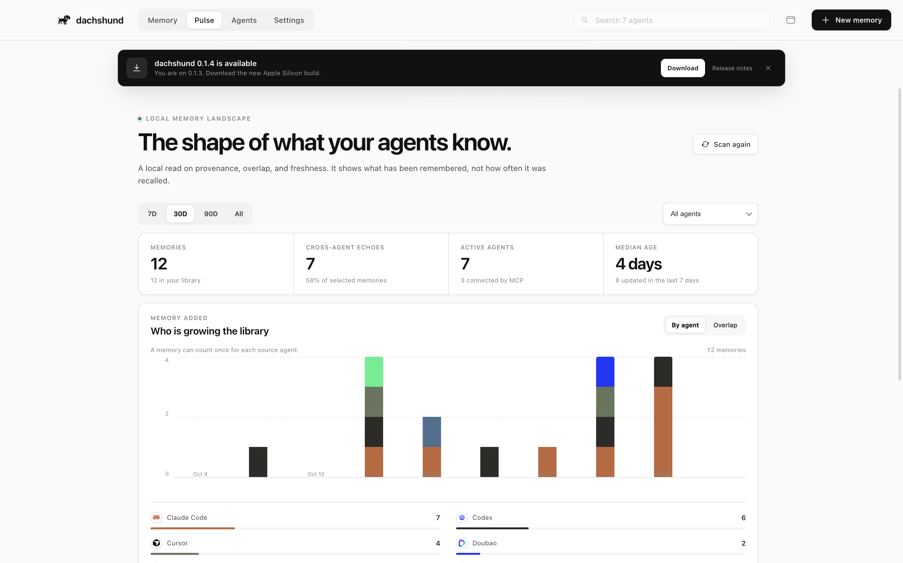
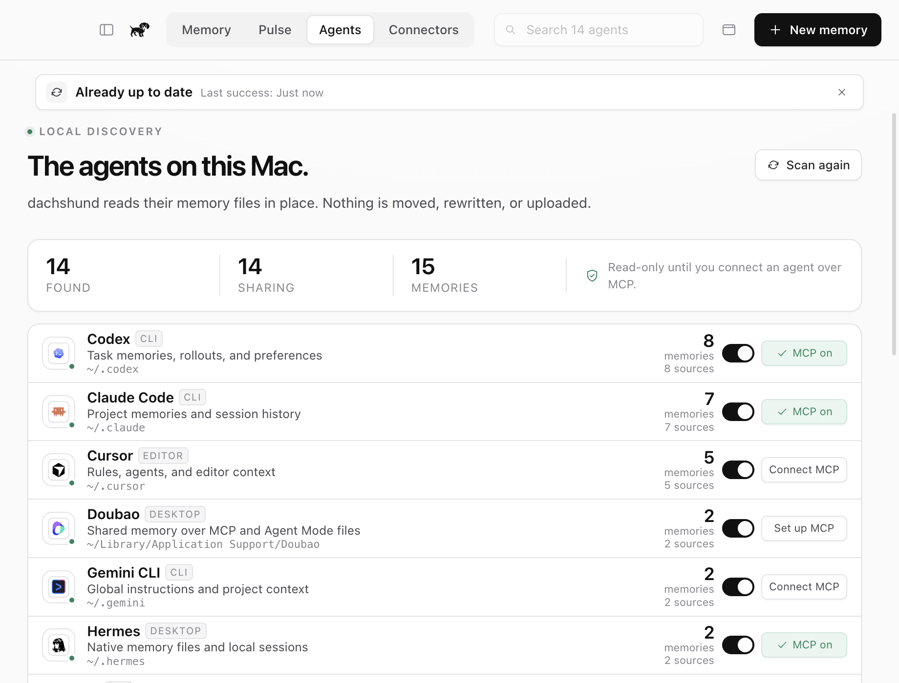
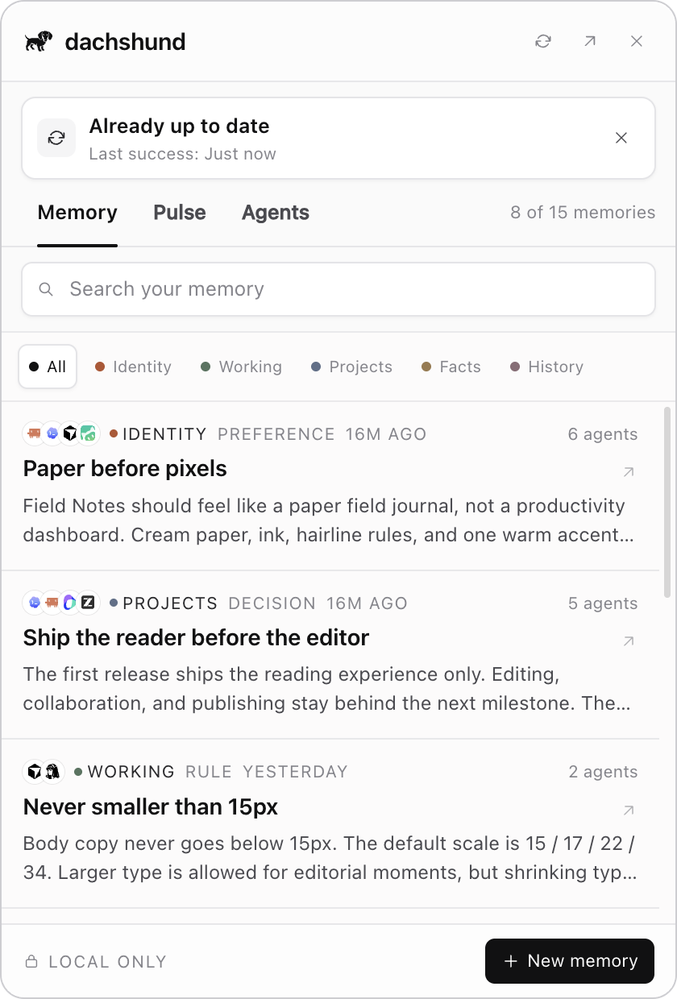

<div align="center">

<a href="https://github.com/Ewen2015/dachshund"></a>

# dachshund

### 每个 Agent 的记忆，收进一个本地入口

**Claude Code 记住一个决定，Codex 记住另一个，Cursor 记住例外。**<br>
dachshund 找到这些 Agent 已经写在本机的 Memory，把它们汇入一份 Markdown
记忆库，再通过 MCP 提供给所有 Agent 使用。无需账号，无需上云，也不依赖模型

[](https://github.com/Ewen2015/dachshund/releases/download/v0.1.13/dachshund-0.1.13-arm64.dmg) [](docs/MVP.md) [](LICENSE) [](#隐私)

**[English](README.md)** &nbsp;·&nbsp; **[简体中文](README.zh-CN.md)**

**[下载](#下载)** &nbsp;·&nbsp; **[首次启动](#首次启动)** &nbsp;·&nbsp; **[支持 Agents](#支持-agents)** &nbsp;·&nbsp; **[工作原理](#工作原理)** &nbsp;·&nbsp; **[文档](#文档)** &nbsp;·&nbsp; **[调研](research/cross-agent-memory-products.md)**

<br>



</div>

<br>

## 为什么需要 dachshund

每个 Agent 都只保留关于你的一部分上下文。项目规则写在 Claude Code 里，失败的
方案留在 Codex 里，排版偏好藏在 Cursor 里。切换工具时，这些上下文不会自动跟过去

dachshund 把已经存在的 Memory 收进一个安静、统一的入口：

- **发现本机已有记忆**：读取 Agent 已知的 Memory 路径，不修改原始文件
- **维护统一记忆库**：把结果保存为普通 Markdown，同时保留来源信息
- **合并跨 Agent 回声**：多个 Agent 记住同一件事时，只保留一份内容并展示全部来源
- **让任意 Agent 召回**：通过仅绑定回环地址的 MCP Bridge 提供搜索、上下文、写入、归档和统计能力
- **常驻但不打扰**：以紧凑的 macOS 菜单栏面板运行，需要时再打开完整记忆库

如果你同时使用多个编码或桌面 Agent，dachshund 适合你。如果一个 Agent 已经完整记住
了所有上下文，你可能并不需要它

## 下载

| 平台 | 架构 | 安装包 | 大小 | 下载 |
| :-- | :-- | :-- | :-- | :-- |
| macOS | Apple Silicon | DMG | 约 120 MB | **[下载 v0.1.13](https://github.com/Ewen2015/dachshund/releases/download/v0.1.13/dachshund-0.1.13-arm64.dmg)** |

**系统要求：** Apple Silicon Mac

> **分发说明：** 当前 MVP 仅提供 ad-hoc 签名，尚未使用 Developer ID 签名，
> 也未经过 Apple 公证。首次打开时，macOS 可能要求你在 Finder 中右键应用并
> 选择“打开”

[所有版本](https://github.com/Ewen2015/dachshund/releases) ·
[SHA256SUMS](https://github.com/Ewen2015/dachshund/releases/download/v0.1.13/SHA256SUMS)

**安装**

1. 下载 DMG
2. 首次安装或恢复时，打开安装镜像，将 `dachshund.app` 拖入“应用程序”一次
3. 从“应用程序”启动 dachshund

从 `0.1.3` 开始，应用内下载完更新后会直接原位替换、自动重启，不再出现第二次
“把应用拖到 Applications”的安装步骤。拖动只用于第一次安装或故障恢复

<details>
<summary>可选：校验下载文件完整性</summary>

SHA-256 用于确认下载的 DMG 与正式发布文件一致。它不是激活码或许可证，不需要
输入到应用中

```sh
cd ~/Downloads
curl -LO https://github.com/Ewen2015/dachshund/releases/download/v0.1.13/SHA256SUMS
shasum -a 256 -c SHA256SUMS
```

</details>

### 从源码构建

需要 Apple Silicon Mac、Node.js 22 或更高版本，以及 npm：

```sh
git clone https://github.com/Ewen2015/dachshund.git
cd dachshund
npm install
npm run dist:mac
```

## 首次启动

**1 · 允许扫描。** 首次启动时，dachshund 会检测本机安装的 Agent，并将已有
Memory 导入：

```text
~/Documents/dachshund/memory/
```

**2 · 连接 Agent。** 打开 **Agents**，为已安装的 Agent 开启共享，再点击
**Connect MCP**。大多数 Agent 只需要 dachshund 自己的 MCP 条目，修改现有配置前会
创建备份；包括豆包在内的应用内连接器则会打开一份本地配置向导

## 支持 Agents

<table>
<tr><td>

Claude Code · Codex · Cursor · Gemini CLI · GitHub Copilot · OpenCode · Windsurf · Claude Desktop · WorkBuddy · Doubao · Trae · Hermes · Pi · ZCode · DeepSeek Harness

</td></tr>
</table>

dachshund 只显示本机实际发现的 Agent。当前 15 个集成都支持只读导入。Claude
Desktop 导入的是本地 Cowork Space memory；普通 Chat memory 仍保存在账号侧，
Claude 通过 MCP 使用 dachshund 的共享记忆。Doubao 的自定义连接器保存在应用内，
因此通过 STDIO 配置向导手动接入；接入后豆包可以通过 MCP 读写 dachshund
的共享记忆，但豆包账号记忆和每个助手的独立记忆仍留在账号侧。

DeepSeek Harness 按事件证据处理，而不是寻找一个原生 memory 文件。dachshund
从人工输入中提取明确的长期线索，把 compaction summary 导入 History，把
`~/.dsh/AGENTS.md` 导入规则，再通过管理的 Cordis MCP 连接共享记忆库。原始
session 和工具输出仍然只是证据，不会直接变成 memory。

具体路径和格式见 [Agent 集成](docs/AGENTS.md)，图标来源与许可见
[Agent 图标](docs/AGENT_ICONS.md)

## 工作原理

```text
Claude Code  ─┐
Codex        ─┼─ 只读导入 ─→ ~/Documents/dachshund/memory/
Cursor       ─┤                         │
其他 Agents  ─┘                         ├─→ SQLite FTS5 + BM25 索引
                                        │
                                        └─→ 127.0.0.1 + Bearer Token
                                                   │
                                                   v
                                            MCP stdio Bridge
                                                   │
                                           所有已连接 Agents
```

Markdown 文件是持久化的事实来源，SQLite 只是可重建的索引。本地 HTTP 服务仅绑定
`127.0.0.1`，MCP Bridge 从仅当前用户可读的运行时文件中获取短期 Token

进程模型、存储约定、安全边界和失败处理见
[架构文档](docs/ARCHITECTURE.md)

## 核心能力

### 先导入，再使用

在手动创建任何 Memory 之前，你就能看到有用的内容。dachshund 支持 Markdown、
WorkBuddy 笔记、Trae 会话 JSONL、Hermes 原生记忆条目、Pi 摘要、ZCode SQLite、
DeepSeek Harness Zstandard 会话日志、Codex Memory 文件，以及可读取的 Codex
SQLite 记录

### 一份记忆，多个来源

多个 Agent 写入相同内容时，dachshund 会合并为一条 Memory，并保留全部来源，方便
追踪内容来自哪里，同时避免记忆库被重复笔记淹没

### 真正适合常驻的 Mac 工具

托盘图标、全局快捷键和 420 × 620 弹出面板让记忆库随手可用。面板会在你正在使用
的屏幕上打开，并停留在当前全屏 Space 上方，不会切换屏幕。使用
`Cmd+Shift+M` 最小化到菜单栏，使用 `Cmd+Shift+D` 打开或关闭紧凑面板。完整应用
可以在顶部 tab 与受 Magpie 产品设计启发的可选侧边栏之间切换：点击窗口左上角
控制按钮旁的侧栏按钮，或按 `Cmd+\`。侧栏模式下，Pulse 归入 Insights。
dachshund 会记住你的选择



### Pulse：看清记忆的形状

Pulse 不是一张为了好看而做的使用量报表。它能看出哪些 Agent 正在扩充记忆库、
多少知识被多个 Agent 共同记住、Memory 在五类中的分布，以及记忆是否正在变旧。
菜单栏小窗里也有同一组数据的紧凑视图



### 在同一个安静入口里完成更新

发布新的 GitHub Release 后，菜单栏面板和完整应用都会出现更新卡片，显示新版本
和发布说明。dachshund 会下载并校验 DMG，然后退出应用，由一个小型独立安装器原位
替换当前版本；新版本会自动重新打开。只有自动替换失败时，才会打开 DMG 作为兜底

<table>
<tr>
<td width="50%"></td>
<td width="50%"></td>
</tr>
</table>

### 不依赖云端 Memory 层的 MCP

已连接 Agent 可以使用以下工具：

- 搜索共享 Memory
- 请求可直接放入 Prompt 的上下文块
- 写入持久 Memory
- 归档共享 Memory
- 查看记忆库统计

| 工具 | 用途 |
| :-- | :-- |
| `memory_search` | 搜索相关 Memory，并返回来源 Agent |
| `memory_context` | 生成紧凑、可直接用于 Prompt 的上下文块 |
| `memory_remember` | 保存一条持久共享 Memory |
| `memory_forget` | 归档共享副本，不删除 Agent 原始文件 |
| `memory_stats` | 显示 Memory、Agent、来源与回声数量 |

### 普通文件，真实身份

即使没有 dachshund，记忆库仍然可读、可迁移。Agent 图标在构建时从固定版本的
MIT 许可 LobeHub 图标集缓存，应用运行时不会请求远程图标

## 隐私

- 无需用户账号，也没有托管服务
- 不包含分析、遥测或远程日志
- 核心路径不需要 API Key、LLM 或 Embedding 调用
- 更新功能只会请求公开的 GitHub Releases 接口
- Agent 文件以只读方式原地扫描，导入过程不会改写原始内容
- 归档共享 Memory 不会删除 Agent 自己的原始文件
- HTTP 服务只监听回环地址，并要求随机 Bearer Token

dachshund 的本地性来自架构，而不是配置开关

## 文档

| | |
| :-- | :-- |
| **[产品](docs/PRODUCT.md)** | 产品定位、用户、界面和边界 |
| **[Memory 分类](docs/MEMORY.md)** | 各 Agent 原生结构、统一分类和归类规则 |
| **[设计](docs/DESIGN.md)** | 视觉系统、布局、动效和无障碍 |
| **[Pulse](docs/PULSE.md)** | Memory 可视化、指标定义和设计取舍 |
| **[架构](docs/ARCHITECTURE.md)** | 进程、存储、MCP 和安全边界 |
| **[Agent 集成](docs/AGENTS.md)** | 支持路径、格式和配置写入方式 |
| **[Agent 图标](docs/AGENT_ICONS.md)** | 固定图标来源和许可 |
| **[MVP](docs/MVP.md)** | 验证结果、校验值和已知限制 |
| **[开发](docs/DEVELOPMENT.md)** | 数据隔离、测试、截图和打包 |
| **[更新](docs/UPDATES.md)** | 发布约定、下载校验与原位安装流程 |
| **[跨 Agent Memory 调研](research/cross-agent-memory-products.md)** | 本地优先 Memory 产品、菜单栏形态与 dachshund 的切入点 |
| **[Memory 分类研究](research/dachshund-memory-taxonomy.md)** | 已实现分类、原生映射，以及明确区分的研究提案 |
| **[各 Agent Memory 结构](research/agent-memory-structures.md)** | 不同 Agent 的存储模型、持久化文件与带日期的证据 |

## 本地开发

```sh
npm install
npm run typecheck
npm run test:agents
npm run build
npm run test:mcp
npm run demo:seed
npm run screenshot
```

开发与测试使用隔离的 `DACHSHUND_HOME` 和 `DACHSHUND_LIBRARY` 目录，不会修改
真实用户的 Agent 配置

## 当前限制

- 去重基于完全相同的内容，不做语义合并
- 搜索使用词法检索，暂不包含本地 Embedding 模型
- 只在启动和手动扫描时导入，没有实时文件监听
- 来源内容修改后，尚未实现增量同步和冲突处理
- 目前只构建 Apple Silicon 版本，且未公证
- 暂不支持云同步、团队模式和多设备历史

## License

[MIT](LICENSE)

dachshund 是独立项目，产品名称和图标归各自所有者。dachshund 的菜单栏、紧凑面板
和部分交互设计受到
[Magpie](https://github.com/yetone/magpie) 启发，在此致谢。dachshund 与 Magpie
团队没有隶属关系，也不复用其品牌资产。
