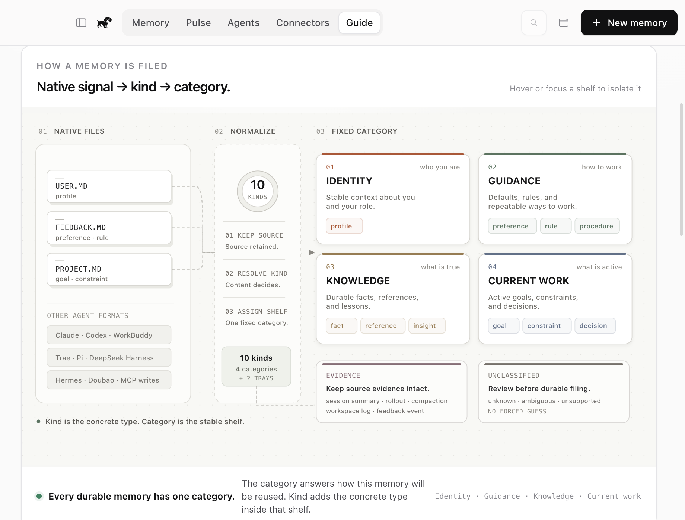

# Memory Taxonomy

dachshund joins memory written under different assumptions: typed project
files, instruction documents, chronological session logs, account-level memory,
and databases with their own schemas. It preserves the native source model while
giving every imported item a stable cross-agent browsing layer.

Each record has four independent dimensions:

1. **Agent**: provenance. The agent name, source path, and source reference are
   shown even when identical content is merged across agents.
2. **Category and kind**: the stable knowledge type used to browse and filter
   the shared library.
3. **Scope**: `user`, `project`, `workspace`, `path`, or `session`.
4. **Authority and status**: who established the record and whether it is
   active, superseded, archived, or awaiting review.

```text
agent file or database
        |
        v
agent-specific importer
        |
        +--> native kind / section / record type
        |          |
        |          +--> kind normalization -> category
        |
        +--> cwd / workspace / session metadata -> scope
        |
        v
Markdown memory + SQLite index + independent filters
```

Classification is deterministic. It does not call an LLM, generate embeddings,
or upload memory for inference.

## Knowledge categories

There are four primary knowledge categories and ten durable kinds. The category
answers what kind of knowledge this is; the kind is the more specific type; the
scope answers what work it belongs to.

| Category | Kinds | Use for |
| --- | --- | --- |
| **Identity** | `profile` | Stable user, role, expertise, and long-lived personal context |
| **Guidance** | `preference`, `rule`, `procedure` | Desired defaults, explicit instructions, and repeatable methods |
| **Knowledge** | `fact`, `reference`, `insight` | Durable facts, pointers to information, and conclusions learned from work |
| **Current work** | `goal`, `constraint`, `decision` | Active objectives, limits, and choices already made |

The fixed category order is Identity, Guidance, Knowledge, Current work. The
category model does not vary by agent.

## Supporting layers

Two supporting layers keep provenance and uncertainty out of the four durable
knowledge categories:

| Layer | Kinds | Purpose |
| --- | --- | --- |
| **Evidence** | `session_summary`, `task_rollout`, `compaction`, `workspace_log`, `feedback_event` | Retains chronological source material without pretending it is durable knowledge |
| **Unclassified** | `unclassified` | Preserves imported content whose native model does not justify a stronger type |

Evidence and Unclassified are visible in browse, agent mapping, and Pulse
surfaces when they contain records. They are visually marked as auxiliary and
are excluded from MCP recall by default. The four knowledge categories remain
visible even when their counts are zero.

## Why these boundaries

- **Identity** is portable across projects. It remains useful when the
  repository, workspace, or agent changes.
- **Guidance** changes future behavior. Preferences are soft defaults, rules are
  explicit constraints, and procedures are repeatable sequences.
- **Knowledge** is durable information that is not necessarily project state.
  An insight records what prior work taught; it is not the raw history itself.
- **Current work** describes active project state. It is intentionally narrower
  than a general project label.
- **Evidence** answers what happened. A session or rollout can later become a
  decision, insight, or reference through an explicit human action. dachshund
  does not silently promote history into a durable claim.
- **Unclassified** is an honest holding state, not a synonym for fact.

## Scope, authority, and status

| Field | Values | Meaning |
| --- | --- | --- |
| `scope` | `user`, `project`, `workspace`, `path`, `session` | Where the memory applies |
| `authority` | `user_explicit`, `project_declared`, `agent_observed`, `inferred` | How strongly the source established the memory |
| `status` | `active`, `superseded`, `archived`, `unclassified` | Current lifecycle state |

The `project` field remains a human-readable project or workspace label. It is
not the same thing as the `project` scope. A Codex rollout can have project
scope and still belong to the Evidence layer.

## Normalization and migration

Importers resolve kind in this order:

1. frontmatter `kind`;
2. frontmatter `type`;
3. nested `metadata.type`;
4. the adapter's file-role default;
5. `unclassified` when no defensible type exists.

Common aliases are normalized before category lookup:

| Native signal | Normalized kind |
| --- | --- |
| `user`, `identity`, `personal` | `profile` |
| `preferences` | `preference` |
| `instruction`, `instructions`, `guideline`, `convention`, `policy` | `rule` |
| `workflow` | `procedure` |
| `objective`, `target` | `goal` |
| `limitation` | `constraint` |
| `link`, `doc` | `reference` |
| `lesson`, `takeaway` | `insight` |
| `session`, `session_memory`, `topic`, `history`, `branch_summary` | `session_summary` |
| `rollout`, `thread` | `task_rollout` |
| `daily_log` | `workspace_log` |
| `unknown` | `unclassified` |

Older values are content-aware:

- `feedback` and `correction` become `rule`, `preference`, `insight`, or
  `unclassified` from explicit signals in the body.
- `project`, `task`, `task_group`, and `project_memory` become `goal`,
  `constraint`, `decision`, `reference`, or `unclassified` from the body.
- `episode` becomes `session_summary`.
- `lesson` becomes `insight`.
- `workflow` becomes `procedure`.

Unknown kinds are preserved as `unclassified`; they never masquerade as facts.

## Agent mapping

The agent detail page explains the native model first, then shows its mapping
into the fixed dachshund categories. A native category may map to exactly one
target row; several native categories may map to the same target category. If a
native concept is visible but not imported, the UI labels it **Not imported**
instead of treating it as available data.

See the [Agent Memory Mapping Matrix](AGENT_MEMORY_MAPPING.md) for every adapter,
concrete native source, target kinds, and known limitations.

## In-app guide

Guide turns this contract into an inspectable product surface. Its top-down
filing plan keeps native files, the normalizer, all ten durable kinds, the four
fixed categories, and the two auxiliary layers legible in one view. Hovering,
focusing, or selecting a category card isolates that route without changing the
library.



## Interface contract

- **All memory** is one timeline sorted by `updatedAt` descending.
- **The category legend** is compact. It shows the four knowledge categories
  and adds Evidence or Unclassified only when those layers contain records.
- **Cards and details** show Type, concrete kind, Scope, Authority, and Status.
  Category and scope are separate labels.
- **Selecting a category then an agent** keeps the category active inside that
  agent view. Agent timelines remain newest first.
- **Agent pages** show the fixed target category order and all native-to-target
  rows, including empty target categories.
- **Pulse** reports the same four knowledge categories plus any auxiliary layer
  that contains data. Clicking a category returns to the filtered memory view.
- **Guide** explains the model in-product with a top-down filing plan. The four
  durable categories, two auxiliary layers, and the orthogonal Scope /
  Authority / Status fields are shown together. Guide is explanatory only and
  never changes classification or filters.
- **The menu bar panel** uses the same taxonomy and click-through behavior as
  the full app.
- **MCP recall** includes durable knowledge by default and excludes Evidence and
  Unclassified records unless a caller explicitly opts in through an internal
  query path.
- **An echo is not a second memory.** Identical content from several agents
  remains one item with multiple sources.
- **MCP writes keep caller provenance.** A write from Codex, Claude, Doubao, or
  another connected client keeps that agent as its source.

## Boundaries

- The taxonomy is curated, not learned. A new agent or memory format requires
  code and tests, not an opaque model update.
- Exact duplicate detection is separate from classification. Echo merging does
  not perform semantic deduplication.
- Different wording is not merged automatically.
- Source files remain read-only. Reclassifying or sharing a memory changes the
  dachshund copy, not the agent's native file.
- Evidence and Unclassified are first-class records for review, but not durable
  knowledge for prompt injection.

The implementation lives in
[`src/shared/memory-taxonomy.ts`](../src/shared/memory-taxonomy.ts). Research
notes and rejected alternatives live in
[`research/dachshund-memory-taxonomy.md`](../research/dachshund-memory-taxonomy.md).
