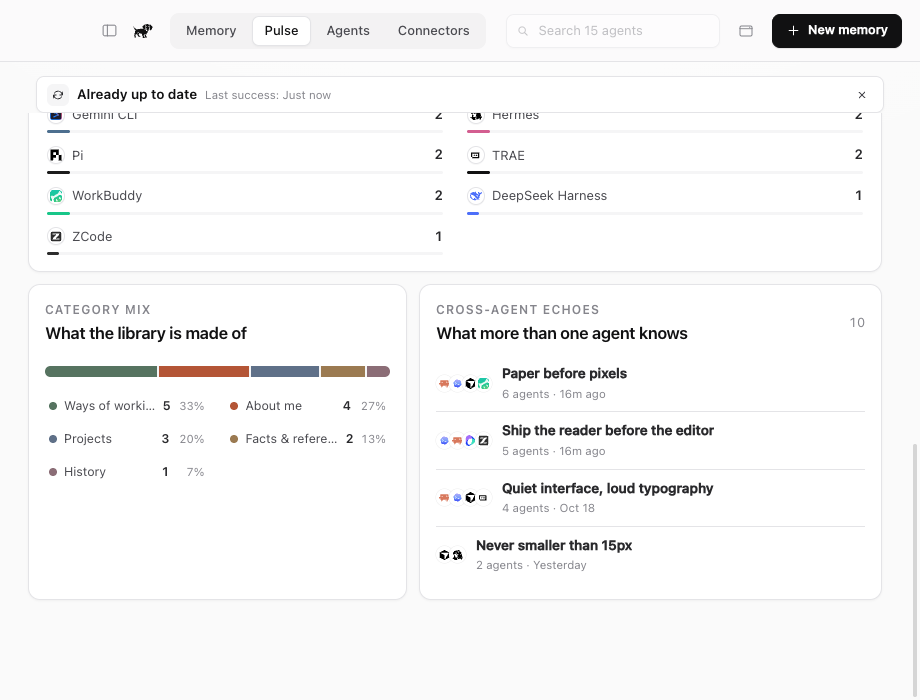

# Pulse

## Purpose

Pulse is the memory visualization tab. In sidebar navigation it belongs to the
Insights group. It answers questions a person can act on, not generic analytics
questions.

| Question | Why it matters | Visual |
| --- | --- | --- |
| What has been remembered recently? | Shows whether the library is alive or dormant. | Memories added over time |
| Which agents contribute? | Reveals a narrow or lopsided memory base. | Stacked bars by source agent |
| What crosses agent boundaries? | Echoes are the core value of dachshund. | Shared versus single-source bars |
| How is memory distributed across dachshund categories? | A library of rules behaves differently from a library of facts. | Category mix bar |
| Is the knowledge getting old? | Old project constraints can mislead an agent. | Median age and last-7-days count |
| How far does the shared layer reach? | Imported memory and MCP-connected memory are different states. | Connected-agent count |

The tab deliberately does not show request counts, token counts, cost, or a
fabricated "memory quality score." The MVP does not instrument recall, and a
deterministic local library should not invent a model-based score.

## Layout

1. **Range filter** - 7, 30, 90 days, or all time.
2. **Agent filter** - one installed agent or all agents.
3. **Summary strip** - memories, cross-agent echoes, active agents, median age.
4. **Growth chart** - additions over time, broken down by agent, dachshund
   category, or overlap.
5. **Series detail** - contribution bars with product marks and counts.
6. **Category mix** - proportion of About me, Ways of working, Projects,
   Facts & references, and History memories.
7. **Cross-agent echoes** - the highest-overlap memories, with source marks and
   direct links into the library.

## Definitions

- **Memory** means one active item in the local Markdown library.
- **Cross-agent echo** means one memory with sources from two or more distinct
  agents. Multiple files from the same agent do not count as an echo.
- **Active agent** means an agent with at least one source in the selected range
  and filter.
- **Connected** means the agent has a dachshund MCP entry installed.
- **Median age** is the median elapsed time since `updatedAt` for visible
  memories.
- **Memory added** uses `createdAt`. Re-importing or updating a memory does not
  increase the growth count.

## Interaction

- Selecting a category, in either the growth series or category mix, opens the
  Memory page with that category filter applied.
- Selecting an agent contribution opens that agent's memory view.
- Selecting an echo opens the memory detail directly.

## Visual Direction

Pulse follows the Magpie-informed product posture already defined in
[DESIGN.md](DESIGN.md): one compact filter row, a divided white summary card,
one restrained chart, and tiny metadata. It is not a business-intelligence
dashboard.

- Agent colors identify provenance and never carry a second meaning.
- The overlap view uses neutral ink and clay rather than agent colors.
- Dotted grid lines replace chart chrome.
- Bars are narrow enough to read as a library rhythm, not a marketing graph.
- Every chart mode has a text summary so color is not the only encoding.

## Data Boundary

Pulse is computed from a dedicated, lightweight index of every active memory.
That index includes only the fields needed for grouping and chart interaction:
identity, title, kind, timestamps, sources, and echo count. It excludes memory
content and excerpts, so the main app state can continue to keep only its latest
90 full memory summaries without making Pulse disagree with the library totals.

Pulse performs no network request, model call, or embedding search. If libraries
grow large enough that even the lightweight index becomes expensive, the next
step is a backend aggregate query rather than increasing the full app-state
payload.

## Future Signals

These become worth adding only when the data exists:

- **Recall coverage** - how often a connected agent searches or reads a memory.
- **Write provenance** - whether an MCP-connected agent created the memory rather
  than whether it was only imported.
- **Conflict rate** - near-duplicate memories whose text diverges.
- **Refresh pressure** - memories tied to projects that have not appeared in a
  recent agent session.

Until then, Pulse should stay small and honest.
