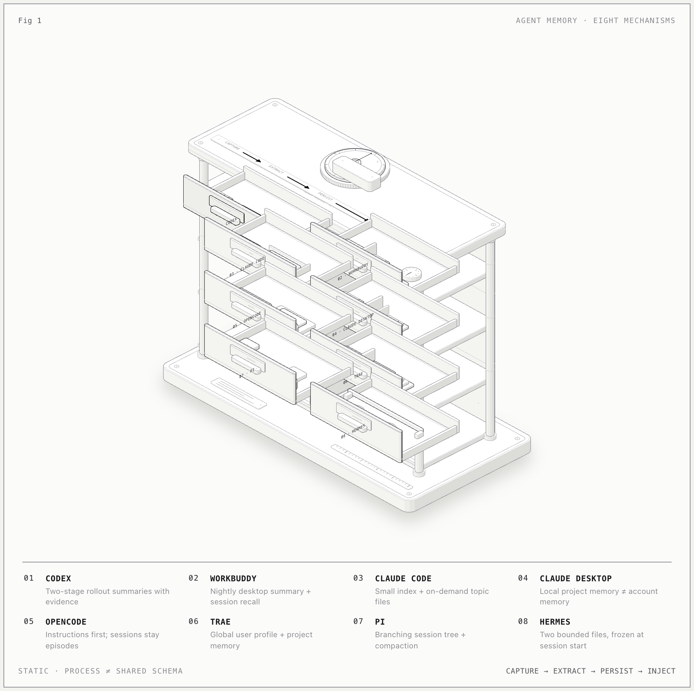
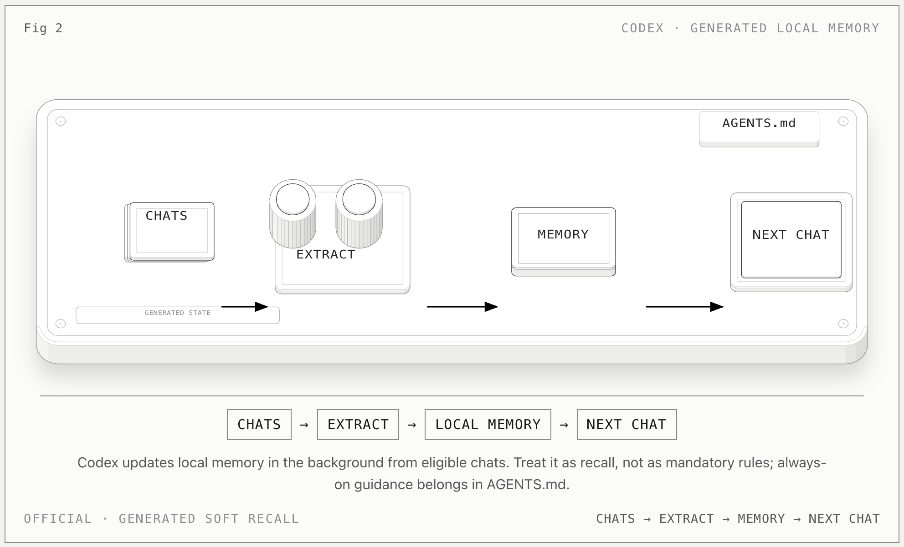
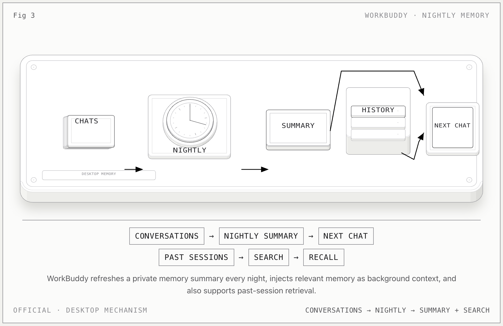
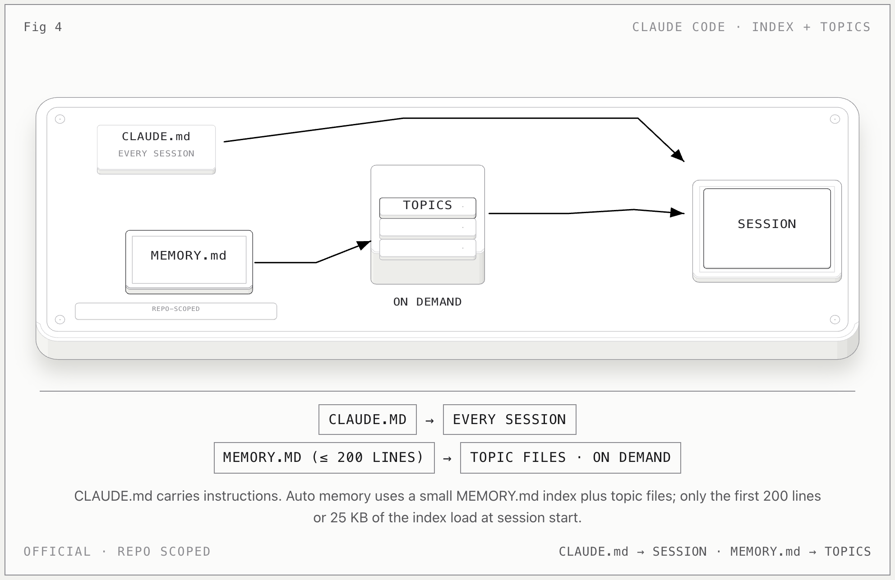
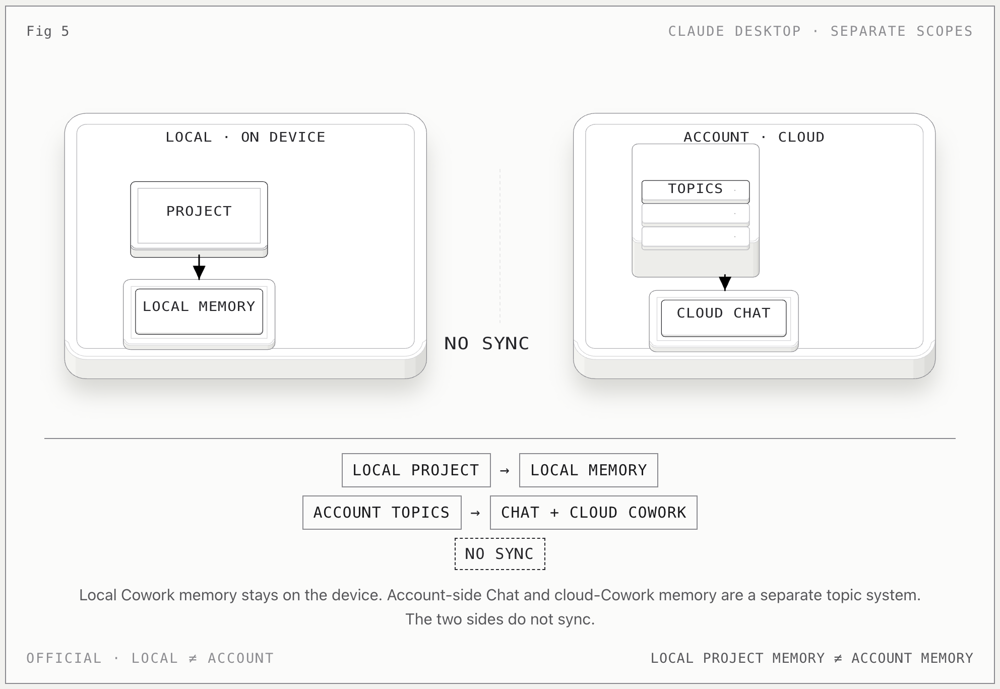
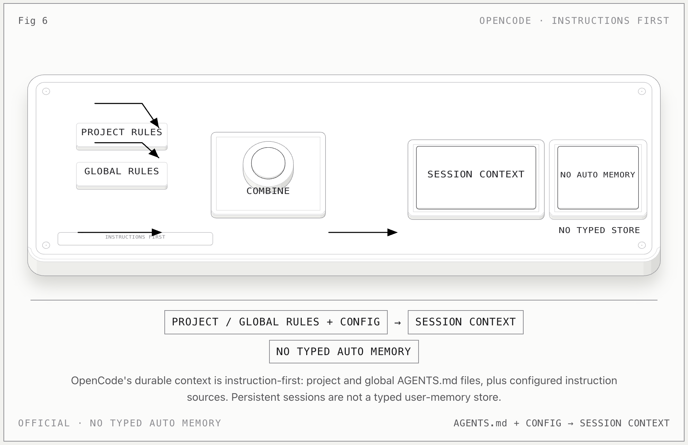
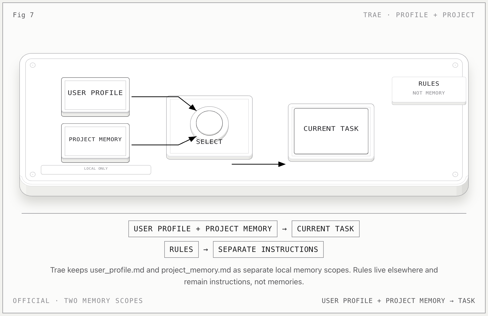
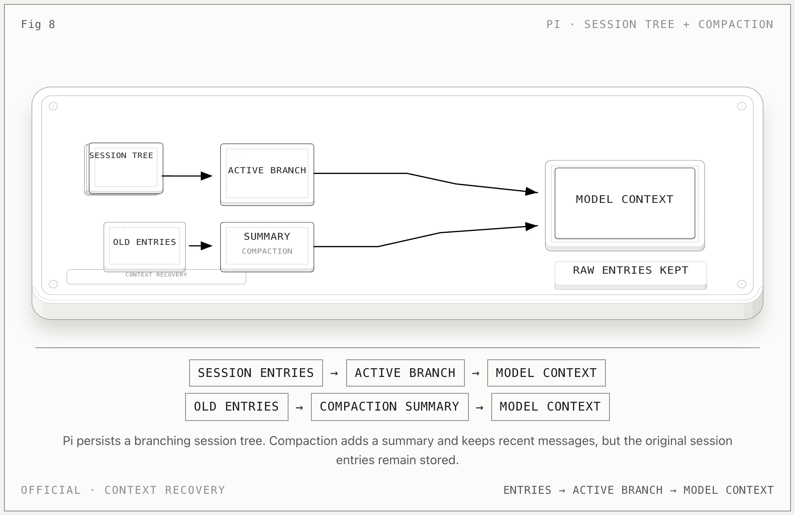
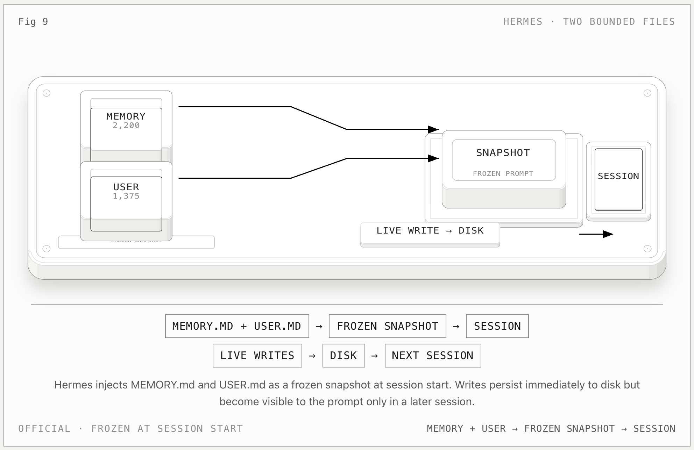

# 八种 Agent 的 Memory 架构

## Codex、WorkBuddy、Claude Code、Claude Desktop、OpenCode、Trae、Pi、Hermes

研究日期：**2026-11-02**

本文研究的不是“哪个产品有 memory”这种是非题，而是一个更具体的问题：

> 每个产品把什么原生对象称为 memory？谁写它？它属于谁？何时进入上下文？
> 它是否可检索、可修改、可追溯？会话、压缩摘要、指令和用户画像之间是什么关系？

结论先说：这八种机制不能压成一张四类型表。

- **Codex** 是“后台提炼 + 全局合并”的两阶段管线；
- **WorkBuddy 桌面版** 是“夜间总结 + 会话检索”，记忆摘要和历史检索是两条不同的路径；
- **Claude Code** 是“小型 MEMORY.md 索引 + 按需 topic files”；
- **Claude Desktop** 同时存在本地项目记忆和账号侧云端记忆；
- **OpenCode** 目前以 instructions-first 为主，持久 session 不是用户长期记忆；
- **Trae** 是“全局 user profile + 项目 memory”，session JSONL 是另一层；
- **Pi** 的核心是 branching session tree 和 compaction，不是用户画像；
- **Hermes** 是“两个有字符预算的 curated files”，并在会话开始时冻结注入。



*八个抽屉代表八种不同的原生记忆对象；图中的编号键、顶部流程箭头和说明均为英文，且为静态图。顶部箭头只表示“捕获 → 提炼 → 持久化 → 注入”的共同生命周期，不代表这些产品共享同一 schema。静态 HTML：[浅色](agent-memory-structures/figure/memory-archive-light.html) / [深色](agent-memory-structures/figure/memory-archive.html)。*

下面每个产品各有一张更简单的官方机制图，方便以后在 dachshund 的 Agent
详情页中单独展示；总览图负责比较，单图负责解释“输入、写入、保存、注入”这条路径。
单页说明以官方文档为主要依据；本总报告后文仍保留公开代码与本机观察，作为补充证据。

## 证据口径

全文用三种标签区分事实强度：

- **官方**：产品当前官方文档明确写出的行为或路径。
- **公开代码**：公开仓库中的实现、schema、测试或规范。
- **本机观察**：研究时本机安装版本产生的文件、数据库或提示词片段；它能证明“这台机器上发生了什么”，不能自动升级为厂商契约。

本文还严格区分四件事：

| 层 | 回答的问题 | 典型对象 |
| --- | --- | --- |
| Instruction | “每次都要遵守什么？” | `AGENTS.md`、`CLAUDE.md`、Rules |
| Durable memory | “跨会话仍应记住什么？” | topic files、bounded memory files、profile |
| Episode / context | “这次任务发生过什么？” | session、rollout、compaction、branch summary |
| Derived index | “怎样快速找到前两层？” | SQLite 表、FTS、摘要索引、`MEMORY.md` |

Instruction 不应该被悄悄归一化成 memory；episode 也不应该因为“被模型总结过”就自动升级成事实；`MEMORY.md` 有时是正文，有时只是索引，必须看具体产品。

## 快速矩阵

| Agent | 原生记忆单元 | 主要写入者 | 主要作用域 | 注入 / 检索 | 持久化 | 不能混淆为 |
| --- | --- | --- | --- | --- | --- | --- |
| **Codex** | rollout 提炼结果、summary、durable entries、evidence | 后台两阶段 agent | 本机用户，跨项目证据可合并 | 汇总进入 memory context；`AGENTS.md` 承担硬规则 | SQLite staging + Markdown workspace + git baseline | 手写指令仓库 |
| **WorkBuddy 桌面版** | 夜间生成的 memory summary；历史会话检索结果 | 桌面应用后台总结 | 用户 / 会话 / 工作区 | 作为 background context 注入；会话检索补充 | `~/.workbuddy` 文件与 `workbuddy.db` | 手写 instruction 仓库 |
| **Claude Code** | `MEMORY.md` 索引 + typed topic files | Claude 自写，也可人工编辑 | Git repo 级，worktree 共享 | 索引自动载入，topic 按需读取 | 项目目录下 Markdown | `CLAUDE.md` 指令 |
| **Claude Desktop** | 本地 project/account topic files；账号侧 topics | 本地 Cowork / Claude 或云端账号系统 | local project / local account / cloud account 三种作用域 | 依据 project 与 local/cloud 模式决定 | 本地 Markdown 或服务端 | 一个统一的“Desktop memory” |
| **OpenCode** | Instructions values；durable sessions | 用户写 instructions；系统记录 sessions | global / project / session | 每轮重新读取 instruction sources；session replay | 内容寻址 instruction store + session DB | typed auto memory |
| **Trae** | `user_profile.md`、`project_memory.md` | AI 可主动增删改，用户也可编辑 | global / project | 全局画像与项目记忆分别注入 | 本地 Markdown | `session_memory_*.jsonl` |
| **Pi** | session tree entries；compaction / branch summary | 运行时与用户操作 | session / branch / cwd | 从当前 leaf 重建模型上下文 | JSONL session files | 跨会话用户画像 |
| **Hermes** | `MEMORY.md` 与 `USER.md` 的条目列表 | agent memory tool | Hermes home / user profile | session start 冻结快照注入 | 两个 bounded Markdown files + session DB | 可热更新的 session context |

## 三种反复出现的架构，而不是一个统一模型

### A. Bounded curated files

Hermes 最纯粹：两个文件、明确字符预算、条目分隔符、启动时冻结。
Trae 也有这个倾向，但它把全局画像和项目记忆拆成两个文件。
Claude Code 则把它扩展成“小索引 + 多个 topic files”。

核心优势是可控：人能看到，能编辑，能放进 git，能预计算 token。代价是写入方必须
知道什么时候压缩、删除和解决冲突。

### B. Generated background consolidation

Codex 与 WorkBuddy 桌面版都属于这一类，但细节不同：

- Codex 先对单个 rollout 并行提炼，再做一次串行的全局合并；
- WorkBuddy 官方描述的是从历史会话做夜间提取，生成 memory summary，并在后续会话中
  作为背景上下文使用，同时保留 session-history retrieval。

这类系统的关键不是“有一个 Markdown 文件”，而是**生成管线**。如果只看最终文件，
会看不到 job lease、重试、证据选择、去重、合并和失效策略。

### C. Append-only episodes + compaction

Pi 是最清楚的样本：原始 entry 继续存在，compaction 只改变模型当前可见的上下文。
OpenCode 也把 session 作为 durable event/projection；Trae 的本机会话 JSONL 也是
episode evidence。

这类结构解决的是“任务怎样继续、上下文怎样重建”，不是“用户是谁”。把它导入
dachshund 时，应该进入 History / Episode，而不是自动写成 About me。

---

## 1. Codex



* **Official view:** eligible past chats → background extraction → local memory
files → future recall. `AGENTS.md` stays outside this loop as an instruction layer.
[单页说明](agent-memory-structures/agents/codex.md)。*

### 原生对象

Codex 的 memory 不是一个手写文件，而是从 rollout 中生成的多层工件：

```text
eligible rollout
  └─ Phase 1: raw_memory + rollout_summary
       └─ SQLite stage1_outputs
            └─ Phase 2: rank + select + workspace diff
                 └─ consolidation agent
                      ├─ memory_summary.md
                      ├─ MEMORY.md
                      ├─ raw_memories.md
                      └─ rollout_summaries/*.md
```

**官方**说明 memory 是 soft recall，不是必须服从的规则；必须每次遵守的内容应写进
`AGENTS.md`。本地 Codex memory 默认关闭，需要显式开启。

**公开代码**进一步把机制写清楚：

- Phase 1 从 State DB claim 一批 idle、非 ephemeral、非 sub-agent 的 rollout；
- 并行提炼，但每个 job 有 lease，避免重复处理；
- 输出版 `raw_memory`、`rollout_summary` 和可选 slug；
- 写入前调用 secret redaction；
- Phase 2 串行获取全局锁，按 usage 与新鲜度选择有限输入；
- 同步 `raw_memories.md` 和 `rollout_summaries/`；
- 用 git-style workspace diff 只把真实变化交给 consolidation agent；
- consolidation agent 无网络、无审批、只有本地 memory root 写权限。

### 存储与格式

**官方文档**列出的典型文件：

- `~/.codex/memories/memory_summary.md`
- `~/.codex/memories/MEMORY.md`
- `~/.codex/memories/raw_memories.md`
- `~/.codex/memories/rollout_summaries/*.md`

**本机观察**到当前活动数据库是 `~/.codex/memories_v2_1.sqlite`，其中可见
`stage1_outputs`、`jobs`、`consolidation_progress` 等表。公开 migration 中
`stage1_outputs` 保存 `raw_memory`、`rollout_summary`、usage、selection watermark；
`jobs` 保存 lease、retry 和 heartbeat 状态。

`memory_summary.md` 的格式非常硬：

- 第一行必须是字面量 `v1`；
- 长度必须小于 10,000 UTF-8 bytes；
- 必须包含 `## User Profile`、`## User preferences`、`## General Tips`、
  `## What's in Memory` 四个标题；
- `MEMORY.md` 是更长的 retrieval-oriented handbook；
- 公开代码的校验逻辑显示：V1 要求 `MEMORY.md`，并会在 Phase 2 重建
  `raw_memories.md`；V2 不再重建 `raw_memories.md`，但同样要求合法的 summary artifact。

### 差异点

Codex 最重要的不是“四类记忆”，而是**两级 writer**：

1. 每个 rollout 的局部提炼；
2. 跨 rollout 的全局合并。

因此同一条最终 memory 可能同时有：

- 最近一次 summary 文本；
- 被选中的 rollout summaries；
- raw memories；
- thread/rollout 来源；
- usage 与 selection metadata。

这比“文件 + frontmatter”更接近一条可重建的数据管线。

### 对 dachshund 的含义

dachshund 不能只导入 `memory_summary.md` 的正文，否则会丢掉 Codex 的证据层。
建议：

- summary 作为 `durable_memory` 或索引；
- `MEMORY.md` 的 task-group block 作为更细的 record；
- `rollout_summaries` 作为 `episode`；
- `raw_memory` 与 SQLite selection metadata 作为 provenance，不直接进入默认检索。

**本机实现缺口**：当前 dachshund importer 查找的是
`~/.codex/memories_1.sqlite` 或 `~/.codex/sqlite/memories_1.sqlite`，而本机实际观察到
`~/.codex/memories_v2_1.sqlite`。这是一个明确的兼容性风险。

## 2. WorkBuddy

本节只讨论 **WorkBuddy 桌面应用**，不涉及其他产品或 CLI。



* **Official view:** conversations → nightly summary → background context in a
future chat; historical session search is a parallel path.
[单页说明](agent-memory-structures/agents/workbuddy.md)。*

### WorkBuddy 桌面应用

**官方**描述：

- 从历史对话做夜间提取；
- 生成 memory summary；
- 后续会话把它作为 background context 注入系统提示；
- 另有 session-history retrieval；
- 用户可查看、编辑、删除；
- 官方明确提醒 summarization drift、时间敏感信息失效和隐私边界。

**本机观察**（WorkBuddy `5.9.3`）：

```text
~/.workbuddy/
  ├─ IDENTITY.md
  ├─ USER.md
  ├─ memory/<uid>_memory.md
  ├─ memery/                 # 历史拼写留下的兼容目录
  └─ workbuddy.db

<workspace>/.workbuddy/memory/YYYY-MM-DD.md
```

`_memory.md` 是人类可读摘要，尾部另有：

```html
<!-- RAW_JSON_START ... RAW_JSON_END -->
```

这一段是应用自己的 raw payload，dachshund 当前会剥离。`workbuddy.db` 可见
`sessions`、`workspaces`、`buddy_snapshots` 等表，但没有观察到独立的 memory 表。

打包提示词片段还显示两种演进形态：

- 较旧的 5.8.x 层：cloud profile、server-side `conversation_search`、本地
  `MEMORY.md`、workspace daily log、workspace `MEMORY.md`，并有每日日志的延迟提炼；
- 5.9.3：出现 `MemoryRecall` / `MemoryUpdate`，workspace project logs 仍单独存在。

这些片段属于**packaged behavior**，不应被写成官方桌面文件契约。

### 差异点

WorkBuddy 桌面版的核心是**时间驱动的总结与检索**。它不是用户手写的 instruction
仓库，也不是“每次对话结束就立刻写一条记录”的 typed file system。

### 对 dachshund 的含义

- 桌面 summary 进入 `durable_memory`，但要保留“由夜间提炼生成”的 authority；
- workspace daily logs 进入 `episode` 或 project observation，不要自动提炼成永久规则；
- 原始 `RAW_JSON` payload 不应默认进入正文，但应保留 ref/hash 作为证据。

## 3. Claude Code

Claude Code 明确有两套完全不同的东西：

1. 用户写的 instructions：`CLAUDE.md`、`AGENTS.md`、`.claude/rules/`；
2. Claude 自写的 Auto Memory。



* **Official view:** `CLAUDE.md` is loaded as instruction; Auto Memory uses a
small `MEMORY.md` index, while topic files stay on disk until Claude reads them on demand.
[单页说明](agent-memory-structures/agents/claude-code.md)。*

### Auto Memory 的物理结构

**官方**路径：

```text
~/.claude/projects/<project>/memory/
  ├─ MEMORY.md
  ├─ feedback_....md
  ├─ project_....md
  └─ ...
```

项目身份按 Git repository 派生，所以同一 repo 的不同 worktree / 子目录会共享
memory。这个边界在本机文件命名中也能看到。

```text
repository
  └─ memory/
       ├─ MEMORY.md          # small index
       └─ <topic>.md         # loaded on demand
```

### 格式

**官方**：

- `MEMORY.md` 是索引；
- 会话开始时只自动载入前 200 行，且受 25KB 上限约束；
- topic files 按需读取；
- 四类 native type：`user`、`feedback`、`project`、`reference`；
- frontmatter 写入 `modified` ISO timestamp；
- memory 是 machine-local，不通过云端跨设备共享。

**本机观察**的 topic frontmatter 还包含：

```yaml
metadata:
  type: feedback
  originSessionId: ...
modified: 2026-...
```

`originSessionId` 是很有价值的 provenance：它把一条长期记忆指回最初产生它的会话。

### 差异点

Claude Code 不是“一个大 MEMORY.md”。它是：

```text
small index  →  on-demand topic files  →  source session
```

索引负责发现，topic 负责细节，frontmatter 负责类型和来源。

### 对 dachshund 的含义

- 保留 native type，不要只映射成 dachshund 的 `profile/preference/...`；
- `originSessionId` 应进入 `native.ref` 或独立的 `source_session` 字段；
- `MEMORY.md` 本身不应该被当成一条内容记录，它是 index；
- topic file 的 `modified` 与文件 mtime 可能不同，导入时应同时保留。

## 4. Claude Desktop

Claude Desktop 的难点不是格式，而是**作用域**。至少有三个不同层次：

1. 本地账号 / Cowork memory；
2. 本地 project memory；
3. 账号侧 cloud memory（Chat 与云端 Cowork）。



* **Official view:** local project/Cowork memory and account-side topics are
separate systems. The diagram deliberately shows a gap, not a sync pipe.
[单页说明](agent-memory-structures/agents/claude-desktop.md)。*

### 本地 storage 模型

**官方 storage reference** 对 Claude Desktop 的本地模型给出：

```text
local-agent-mode-sessions/
  ├─ .../memory/memory/              # local account / Cowork memory topics
  └─ .../spaces/<projectId>/memory/  # local project memory
```

本地 account memory 旁还有一个 `CLAUDE.md` instructions file。

关键规则：

- project 内的 Cowork 与 Chat 会读写 project memory；
- project 外的 Chat 不读写本地 memory；
- local memory 不离开设备；
- local storage 模型不能自动外推到所有云端 Desktop 配置。

**本机观察**的一个 Space 包含：

```text
spaces/<projectId>/memory/
  ├─ MEMORY.md
  └─ feedback_git_push_credentials.md
```

topic frontmatter 有 `name`、`description`、`metadata.type`、
`metadata.originSessionId`、`modified`。

### 账号侧 memory 是另一套

**官方 support 文档**描述的是账号侧 Chat search / memory：

- 由一组独立 topics 构成；
- cloud Chat 与 cloud Cowork 可共享；
- local Cowork 不使用账号侧 memory；
- Projects 有自己的 memory；
- memory 可以在对话中新增、更新或删除，不一定等到夜间总结。

### 差异点

Claude Desktop 不能写成“本地 project memory 会同步到账号”。正确说法是：

```text
local project memory  ──X──  account-side cloud memory
cloud Chat + cloud Cowork ──shared account topics──┐
local Cowork ── local-only memory ─────────────────┘
```

### 对 dachshund 的含义

必须有独立的 `scope` 和 `storage_domain`：

- `scope=project` / `scope=account`；
- `storage_domain=local` / `cloud`；
- `native.kind=memory_index|topic|claude_md`；
- 本地 topic 可以导入，账号侧 memory 只能通过明确授权或 MCP/API 获得。

## 5. OpenCode

OpenCode 是一个典型的 **instructions-first** 产品。



* **Official view:** project/global `AGENTS.md` and configured instruction
sources feed session context. The empty tray marks the absence of a documented typed
auto-memory store. [单页说明](agent-memory-structures/agents/opencode.md)。*

**官方 Rules 文档**给出的 durable context 主要是：

- 项目 `AGENTS.md`；
- 全局 `~/.config/opencode/AGENTS.md`；
- `CLAUDE.md` fallback；
- `opencode.json` 的 additional instructions。

截至研究日期，没有发现官方定义的、与 Claude Code 同等级的 typed auto-memory
契约。dachshund 当前探测的 `~/.config/opencode/memory` 和
`~/.local/share/opencode/memory` 也没有观察到稳定 memory store。

### 公开代码中的真正区别

OpenCode 的公开代码实现了一个很值得借鉴的 instruction 机制：

```text
instruction sources
  → canonical JSON
  → SHA-256
  → instruction_blob
  → chronological instruction delta
  → frozen rendered update
```

`packages/core/src/instructions/index.ts` 用 SHA-256 对 instruction value 做内容寻址；
`instruction_blob` 只保存规范 JSON body；变化以 delta 进入 durable event。

同时，OpenCode 的 session 是另一条线：

- session / inbox / transcript 是 durable projections/events；
- compaction 只重建 active model history；
- 原始 transcript 仍然保留。

### 差异点

OpenCode 的“会持久化”不等于“有用户 memory”：

- instruction 是每轮可重新计算的配置值；
- session 是任务证据；
- compaction 是上下文窗口管理；
- 没有证据表明存在跨项目用户画像文件。

### 对 dachshund 的含义

- 不要把 `AGENTS.md` 导入成 `profile`；
- 可以把 instruction value 作为 `authority=instruction`，并记录 SHA-256；
- session 只作为 `episode`；
- 如果未来支持 OpenCode 的 memory，必须先有公开 schema 或明确的版本观察。

## 6. Trae

Trae 官方把 Rules 与 Memory 分开。



* **Official view:** global `user_profile.md` and project
`project_memory.md` are two local memory scopes; Rules remain a separate instruction
system. [单页说明](agent-memory-structures/agents/trae.md)。*

### Rules

- 全局：`~/.trae/user_rules`；
- 项目：`.trae/rules/`；
- 兼容 `AGENTS.md` / `CLAUDE.md`。

Rules 是 instruction，不是 memory。

### Memory

**官方**：

```text
~/.trae/memory/user_profile.md
~/.trae/memory/projects/{project_path}/project_memory.md
```

- 本地保存，不跨设备；
- AI 可主动创建、更新、删除；
- 一次性指令、模糊偏好、敏感信息默认不保存；
- global profile 和 project memory 是两个作用域。

**本机观察**（中文发行版目录）：

```text
~/.trae-cn/memory/
  ├─ user_profile.md
  ├─ topics.md
  ├─ <encoded-project>/
  └─ session_memory_*.jsonl
```

session JSONL 可见字段：

```text
actions
compact_summary_meta
intent
learned
message_id
message_summary_time
outcome
```

这些字段更像 episode summary，而不是官方说的 durable project memory。研究时没有在
本机找到 `project_memory.md`，但官方路径仍然成立；这只能说明当前安装/项目尚未生成它。

### 差异点

Trae 的 `user_profile.md` 与 `project_memory.md` 是 durable；
`session_memory_*.jsonl` 是历史；Rules 是 instruction。三者不能混在一起。

### 对 dachshund 的含义

- profile → `authority=durable_memory`, `scope=user`；
- project memory → `authority=durable_memory`, `scope=project`；
- session memory → `authority=episode`；
- `learned` 字段不能直接升级成事实，除非能定位其来源和适用条件。

## 7. Pi

Pi 没有把“用户长期记忆”设为核心对象。它最核心的是 **session tree**。



* **Official view:** the model reads the active branch while the session tree
retains all branches; compaction adds a summary and a new context boundary without
deleting the original entries.
[单页说明](agent-memory-structures/agents/pi.md)。*

### 物理格式

**官方**路径：

```text
~/.pi/agent/sessions/--<path>--/<timestamp>_<session-id>.jsonl
```

当前 v3 session：

- 第一行是 `type=session` header；
- 每个 entry 有 `type`、`id`、`parentId`、`timestamp`；
- entry 类型包括 `message`、`model_change`、`usage`、`compaction`、
  `context_edit`、`branch_summary`、`custom`、`label`、`session_info`；
- `parentId` 形成树，切换分支不需要复制整个文件；
- `context_edit` 可以只影响未来模型上下文，不修改原始 entry。

### Compaction 不是长期记忆

`CompactionEntry` 保存：

- `summary`
- `firstKeptEntryId`
- `tokensBefore`
- 可选 `systemMessage`

原始 entries 仍在 JSONL 中。下一次构建上下文时，Pi 从当前 leaf 回溯，遇到最新的
compaction 就用 summary + retained recent entries 替换旧上下文。

这就是关键差异：

```text
raw session history  ≠  model-visible context
```

compaction 改变的是第二条，不是第一条。

### 对 dachshund 的含义

- session tree → `episode`；
- compaction → `episode.summary`，不是 profile；
- branch summary → 另一条 episode evidence；
- 若要导入用户长期事实，只能从明确的用户陈述或人工 curated record 进入，不能把
  compaction 自动提升。

## 8. Hermes

Hermes 把长期记忆做成两个有明确所有者语义的 bounded files：



* **Official view:** `MEMORY.md` and `USER.md` are loaded as a frozen snapshot
at session start. Live writes persist to disk but enter the prompt only in a later
session. [单页说明](agent-memory-structures/agents/hermes.md)。*

```text
~/.hermes/
  ├─ memories/MEMORY.md   # agent notes: environment, conventions, learned facts
  ├─ memories/USER.md     # who the user is, preferences, expectations
  └─ state.db             # sessions + FTS5 search
```

### 格式

**官方**与**公开代码**一致：

- `MEMORY.md` 默认上限 2,200 chars；
- `USER.md` 默认上限 1,375 chars；
- 条目之间用 `\n§\n` 分隔；
- 两个文件在 session start 作为 FROZEN snapshot 注入系统提示；
- 会话中的写入会立即落盘，但不会改变本次已注入的 prompt，只在下一次 session
  可见；
- 工具动作是 `add`、`patch`、`remove`，不再提供 `replace`；
- 完全重复的条目会被视为 no-op；
- 写入会扫描 injection / exfiltration / invisible Unicode；
- 一批操作可以用“最终预算”原子地删除、缩短并新增；
- `state.db` 的 session 历史与长期 memory 是两条线。

### 为什么这里的“文件格式”很重要

Hermes 不是 Markdown 即 memory。它有三个约束同时成立：

1. **字符预算**：模型必须主动整理；
2. **冻结快照**：同一 session 内不会让 prompt 前缀变化；
3. **条目边界**：`§` 让 patch/remove 有可寻址的最小单位。

这使它比“大段 Markdown 作为 system prompt”更可审计，也更适合做稳定 prefix cache。

### 对 dachshund 的含义

- 保留 `MEMORY.md` 的 agent-owned 语义，不要强行映射成 project fact；
- `USER.md` 是明确的 user profile；
- `§` 应保留成 canonical entry boundary，而不是导入时直接换成句号；
- `state.db` 只作为 episode evidence 和 session search，不默认进入 durable store。

---

## 格式比较：不是哪种“更先进”，而是解决不同问题

| 格式 | 代表 | 优点 | 风险 | 适合 dachshund 的部分 |
| --- | --- | --- | --- | --- |
| Single bounded file | Hermes | 可读、可控、前缀稳定 | 容易满、需要强整理 | profile / pinned core |
| Index + topic files | Claude Code、Claude Desktop | 低 token 索引、按需详情、文件可读 | 索引可能漂移，topic 需要发现规则 | canonical library |
| Generated summary + evidence | Codex | 可扩展、可追溯、自动更新 | 管线复杂，文件不是全部真相 | importer + provenance |
| SQLite staging + Markdown workspace | Codex | 任务锁、重试、ranking、diff 很强 | 不透明，迁移成本高 | internal pipeline |
| Content-addressed instruction values | OpenCode | 精确 diff、历史可重放、无重复正文 | 不是用户记忆 | instruction layer |
| Tree JSONL + compaction | Pi | 分支、回放、审计强 | 不是长期事实模型 | episode store |
| Delimiter-separated entries | Hermes | 易 patch、易限额、边界清楚 | 不适合复杂层级 | durable entries |

## 给 dachshund 的格式建议

下面全部是**未来设计建议**，不是当前已实现行为。

### 1. Canonical：Markdown record + YAML frontmatter

继续把 Markdown 作为人类可读的 source of truth，但每一条记录都要比当前 frontmatter
多保留“权威、作用域、原生来源、版本、生命周期”：

```yaml
---
schema_version: 1
id: mem_01J...
title: Prefer direct answers before caveats
kind: preference
authority: durable_memory
scope: user
native:
  agent: claude-code
  kind: feedback
  path: ~/.claude/projects/<repo>/memory/feedback_direct.md
  ref: claude-code:feedback_direct
content_hash: sha256:...
source_revision: sha256:...
created_at: 2026-10-30T08:15:00Z
updated_at: 2026-11-02T02:10:00Z
observed_at: 2026-11-02T06:00:00Z
status: active
confidence: high
supersedes: []
conflicts_with: []
project_id: github.com/ewen/dachshund
---
```

字段职责要分开：

| 字段 | 不能替代什么 |
| --- | --- |
| `kind` | 只回答“信息用途”，不能回答“是否必须遵守” |
| `authority` | `instruction / durable_memory / episode / observation` |
| `scope` | `profile / user / machine / project / workspace / session` |
| `native` | 原生产品、原生 kind、精确路径、ref，保留不可翻译的差异 |
| `content_hash` | 规范化后内容 hash，不是去重后的 semantic identity |
| `source_revision` | 上游文件/记录的 revision，用于增量同步 |
| `observed_at` | 我们何时看到，不是上游何时修改 |
| `supersedes` / `conflicts_with` | 不做自动语义合并，只显式标冲突 |

### 2. Runtime interchange：JSON / JSONL

Markdown 适合人读，不适合所有机器同步。需要一个可重建的交换层：

```json
{
  "schema_version": 1,
  "event_id": "evt_01J...",
  "op": "upsert",
  "record_id": "mem_01J...",
  "source": {
    "agent": "hermes",
    "kind": "USER.md",
    "path": "~/.hermes/memories/USER.md",
    "revision": "sha256:..."
  },
  "observed_at": "2026-11-02T06:00:00Z",
  "payload_ref": "records/mem_01J....md"
}
```

建议：

- append-only JSONL 记录 `upsert / delete / supersede / conflict`；
- 大正文不重复塞进每条 event，只放 `payload_ref` 和 hash；
- native payload 如需保留，放在可选的 `raw/` 下，默认不参与检索；
- JSONL 可被重放，Markdown 可被人编辑，两者通过 `record_id` 和 hash 对齐。

### 3. Derived index：SQLite / FTS 只做派生

SQLite 适合：

- FTS5 全文检索；
- kind / authority / scope / project / status 过滤；
- source path 和 observed_at 索引；
- conflict / supersession 查询。

但 SQLite 不应成为唯一 canonical store。原因很直接：

- 用户无法直接 review；
- git diff 不友好；
- 迁移工具很容易只复制 schema，丢掉语义；
- 各产品的 memory 机制仍在快速变化。

### 4. 三类记录入口

dachshund 导入器最好明确区分：

```text
instruction source  →  authority=instruction
durable memory file →  authority=durable_memory
session / rollout   →  authority=episode
raw observed file   →  authority=observation
```

默认行为应是：

- instruction 不自动加入“我”或“工作方式”，除非用户确认；
- episode 不自动总结成 durable fact；
- 同一内容在不同 authority 下可以共存，不做跨层去重；
- 同一 native record 的更新通过 `source_revision` 判定，不用文本相似度猜。

### 5. 项目身份

Claude Code 的“repo 级共享”是本报告里最值得借用的作用域规则。dachshund 不应只用
临时目录或绝对路径当 project identity，至少应记录：

```text
project_id:
  git remote normalized URL
  fallback: canonical worktree root
```

这样同一 repo 的不同 worktree 可以共享项目记忆，而临时副本不会误命中。

### 6. 检索与注入

推荐两级 retrieval：

1. **Core**：pin 的 profile、稳定 preference、明确规则，少量、始终可见；
2. **On demand**：按 project、kind、authority、query 检索 topic/episode。

`MEMORY.md` 作为人读索引可以保留，但不要让所有正文都挤进一个自动加载文件。

## 迁移路线

### Phase 1：只读导入，不合并

- 为每个 importer 保存 source path、mtime、size、hash、native kind；
- 保留一级 native payload；
- 在 UI 中显示 “native / imported / derived” 三种状态。

### Phase 2：canonical Markdown

- 一条 record 一个 `.md`；
- 先写 frontmatter，再写正文；
- 生成 `MEMORY.md` 索引；
- 用 `content_hash` 做精确重复，不做语义合并。

### Phase 3：source revision 与 lifecycle

- 检测上游文件变化；
- 允许 `superseded_by`、`conflicts_with`；
- 被删除的源记录标记为 `source_missing`，不立即删除 canonical record；
- 在 UI 展示“最后观察时间”和“最后上游更新时间”。

### Phase 4：MCP / retrieval

- 暴露 `memory_search`、`memory_get`、`memory_sources`；
- 返回时始终带 `authority`、`scope`、`native agent`、`source path` 和 `observed_at`；
- 对 instruction 与 memory 使用不同的 tool description；
- 不向 agent 返回没有 provenance 的“绝对事实”。

## 不应该做的事

1. **不要把八种机制硬映射成四个 type。**
   `user / feedback / project / reference` 是 Claude Code 等产品的
   native contract，不是所有 agent 的共同本体。

2. **不要把 `MEMORY.md` 当成同一种东西。**
   Hermes 的 `MEMORY.md` 是正文条目；Codex 的 `MEMORY.md` 是更长的 handbook；
   Claude Code 的 `MEMORY.md` 是索引。

3. **不要把 compaction 当长期记忆。**
   Pi、OpenCode、Trae 的 compaction/session summary 首先是重建上下文的机制。

4. **不要把 account memory 与 local memory 合并。**
   Claude Desktop 是当前最清楚的例子：本地 project memory 与账号 topics 不是同一层。

5. **不要用语义相似度自动覆盖旧记忆。**
   先保存两条，显示冲突和来源，再让用户或明确的 consolidation policy 决定。

6. **不要默认导入敏感原文。**
   Codex 有 secret redaction；Hermes 有 injection/exfiltration 扫描。dachshund 至少需要
   可配置的 redaction、原始 payload 隔离和导出前审计。

## 当前 dachshund 实现位置

这部分是代码现状，不是建议：

- `src/shared/memory-taxonomy.ts`：五类 category、十一种 kind 和 agent mapping；
- `src/main/store/library.ts`：Markdown + YAML frontmatter，一条记录一个文件；
- `src/main/store/db.ts`：SQLite + FTS5，内容 hash 使用 lowercase normalized SHA-1；
- `src/main/agents/importers.ts`：各产品的文件探测、Markdown/JSONL 解析和 kind inference；
- `docs/ARCHITECTURE.md`：Markdown 是 canonical，SQLite 是 derived index；
- `docs/MEMORY.md`：当前产品语义和 mapping。

当前已经做得好的地方：

- canonical library 是 Markdown；
- SQLite 可重建；
- source path/ref 被保留；
- 把 `episode` 与 durable memory 分成不同 category；
- `memory_context` 明确把检索结果标为 context，而不是 instruction。

需要补的地方：

- `authority`、`scope`、native kind、source revision 还不是一等字段；
- hash 仍是 SHA-1，且只做 lowercased/non-alphanumeric-normalized 精确去重；
- 没有完整的 supersession / conflict / source_missing lifecycle；
- Codex SQLite 版本探测落后于本机 `memories_v2_1.sqlite`；
- 部分 importer 仍依赖文件名和启发式推断，不能把推断结果当成 native schema。

## 参考资料

完整链接、提交 SHA、本机观察列表见 [sources.md](sources.md)。

本文的核心判断可以压缩成一句话：

> **dachshund 要统一的不是“记忆内容长什么样”，而是“来源、权威、作用域、版本和生命周期怎样被保留”；正文格式应保持 Markdown，机器交换用 JSONL，SQLite 只做派生索引。**
