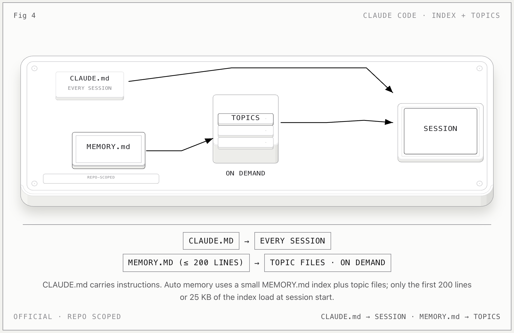

# Claude Code Memory

**一句话：** Claude Code 把“你写的指令”和“Claude 自己写的记忆”分开：`CLAUDE.md` 是指令，Auto Memory 是小型 `MEMORY.md` 索引加按需读取的 topic files。

## 记忆怎么流动

1. `CLAUDE.md` 由用户维护，每个 session 载入；项目、用户和组织都能有自己的指令。
2. Auto Memory 由 Claude 自己写，保存四类笔记：`user`、`feedback`、`project`、`reference`。
3. 每个 repo 有一个共享的 memory 目录：`~/.claude/projects/<project>/memory/`。
4. 每次 session 只自动载入 `MEMORY.md` 的前 200 行或前 25 KB，取先到者。
5. 详细内容拆到 topic files；Claude 需要时再通过文件工具按需读取。

## 关键边界

- `CLAUDE.md` **不是** Auto Memory；一个是用户写的 instruction，一个是 Claude 写的 learning。
- `MEMORY.md` 是索引，不是把所有记忆塞在一起的正文。
- Auto Memory 是 machine-local；同一 Git repo 的 worktree 和子目录共享，但不跨设备或云环境同步。
- 主对话的 Auto Memory 默认不进入 subagent；fork 是例外。

## 官方依据

- [How Claude remembers your project](https://code.claude.com/docs/en/memory)

[返回总览](../../agent-memory-structures.md)
