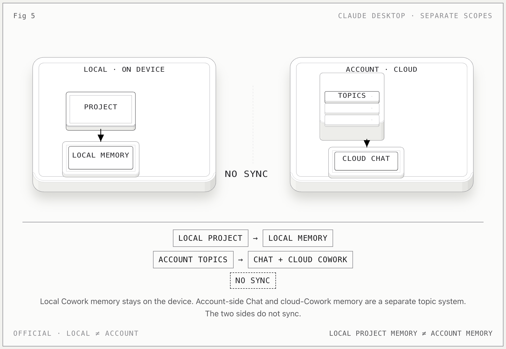

# Claude Desktop Memory

**一句话：** Claude Desktop 同时存在本地 project memory 和账号侧 memory；本地 Cowork 记忆留在设备上，账号 topics 由云端 Chat / cloud Cowork 使用，两边不是一套文件。

## 本地机制

1. Cowork 会把用户偏好、项目上下文和纠正保存成短 Markdown notes。
2. 全局 Cowork memory 位于 `local-agent-mode-sessions/.../memory/memory/`，旁边还有 `CLAUDE.md` 全局指令。
3. 每个 project 另有自己的 `spaces/<projectId>/memory/`，project 内的 Cowork 和 Chat 可以读写它。
4. 不在 project 内的 Chat 不读取也不更新本地 project memory。
5. 本地 memory 不离开设备。

## 账号机制

- 账号侧 memory 由一个个 **topics** 组成，不等对话结束再统一总结。
- cloud Chat 与 cloud Cowork 可以共享这些 topics。
- local Cowork 不使用账号侧 memory。

## 关键边界

- **local ≠ cloud**，**project memory ≠ account memory**。
- “本地 project memory 会同步到账号”是错误理解；默认没有这条同步路径。
- 判断时同时看 `scope`（account / project）与 `storage_domain`（local / cloud）。

## 官方依据

- [Claude Desktop data storage](https://claude.com/docs/third-party/claude-desktop/data-storage)
- [Chat search and memory](https://support.claude.com/en/articles/11817273-use-claude-s-chat-search-and-memory-to-build-on-previous-context)

[返回总览](../../agent-memory-structures.md)
