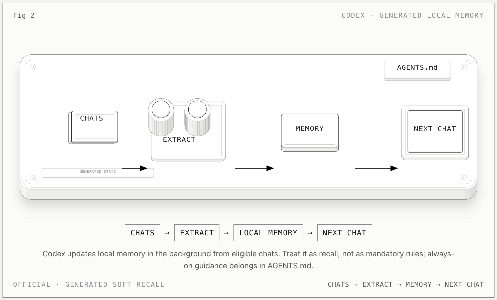

# Codex Memory

**一句话：** Codex 会从符合条件的过往对话里提炼本地 memory，在后续会话中作为 recall context 使用；必须一直遵守的规则仍然放在 `AGENTS.md`。

## 记忆怎么流动

1. Codex 等待一段对话进入 eligible、idle 状态，而不是在每次对话结束时立即写入。
2. 它在后台从过往对话中生成有用的上下文，并把结果保存到本机 Codex home 下的 memory 文件。
3. 后续会话可以注入这些 memory，帮助 Codex 接续以前的工作。
4. 聊天级 `/memories` 可以单独控制“使用旧 memory”和“允许本聊天生成未来 memory”。

## 关键边界

- 这是 **soft recall**，不是最高优先级指令；长期规则写 `AGENTS.md` 或仓库文档。
- 官方把 memory 文件称为 **generated state**，不建议把它们当成主要手写控制面。
- local Codex clients 使用独立的本地 memory store；ChatGPT web 使用另一套 ChatGPT memory。
- 本机观察到的 SQLite 管线与证据文件属于实现层，不改变上面的官方产品契约。

## 官方依据

- [Memories](https://learn.chatgpt.com/docs/customization/memories?surface=app)

[返回总览](../../agent-memory-structures.md)
