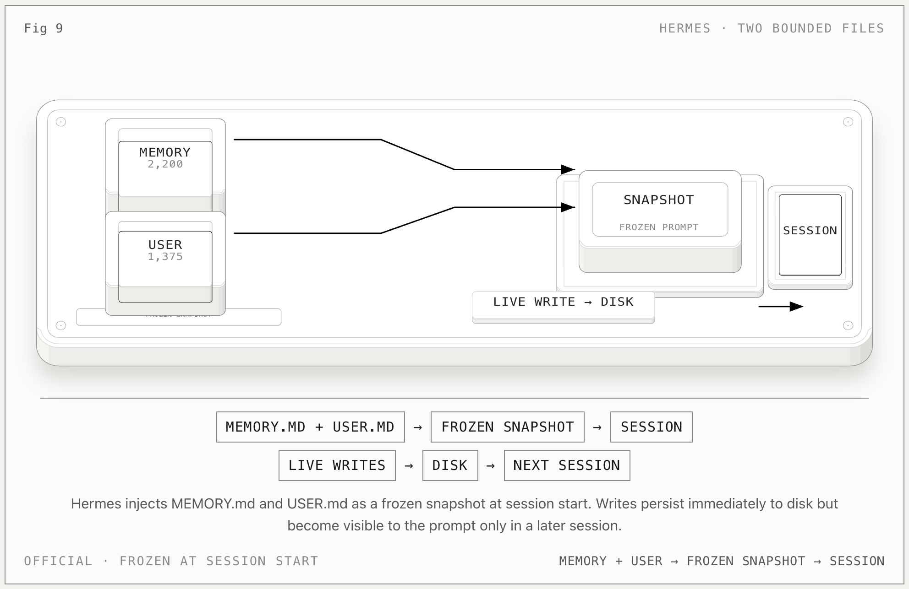

# Hermes Memory

**一句话：** Hermes 用两个有字符上限的文件保存长期记忆，并在 session start 把它们冻结成 system-prompt snapshot；会话中的写入立刻落盘，但下一次 session 才进入 prompt。

## 记忆怎么流动

1. `MEMORY.md` 保存 agent 自己的笔记：环境、约定、学到的事实，默认最多 2,200 chars。
2. `USER.md` 保存用户画像、偏好、沟通方式，默认最多 1,375 chars。
3. 两个文件都位于 `~/.hermes/memories/`。
4. Session 开始时，读取两个文件并作为 frozen snapshot 注入 system prompt。
5. Agent 通过 memory tool 执行 `add`、`patch`、`remove`；写入立即持久化。
6. 当前 session 的 prompt 不变，下一次 session 才载入新版本。

## 关键边界

- 条目之间默认用 `§` 分隔，字符预算迫使 agent 主动整理。
- 文件已写入 ≠ 当前 session 已看到；frozen snapshot 是核心。
- `MEMORY.md` 是 agent notes，`USER.md` 是 user profile，两者不是同一 scope。
- session search 读取历史数据库，不应自动替代两个 bounded files。

## 官方依据

- [Hermes Persistent Memory](https://hermes-agent.nousresearch.com/docs/user-guide/features/memory)

[返回总览](../../agent-memory-structures.md)
