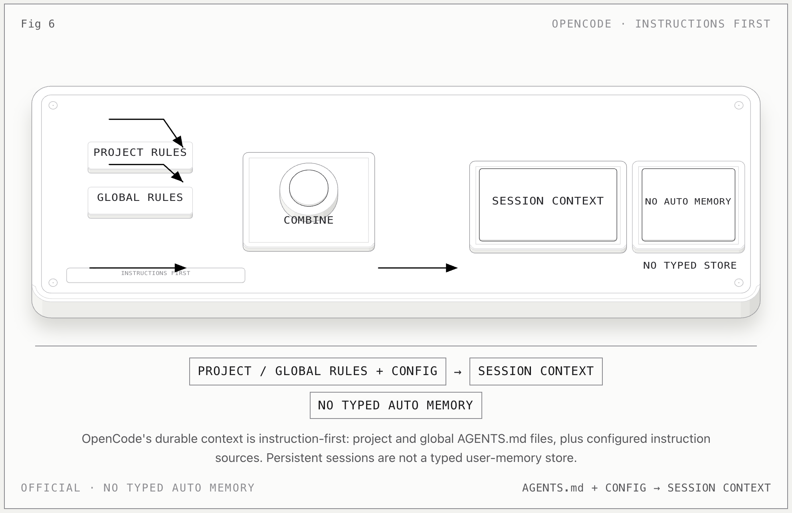

# OpenCode Memory

**一句话：** OpenCode 当前是 instructions-first：项目、全局和自定义 instruction sources 定义持久上下文；官方 Rules 文档没有定义一套 typed auto-memory store。

## 上下文怎么流动

1. 项目根目录的 `AGENTS.md` 提供项目规则，向上遍历定位。
2. 全局 `~/.config/opencode/AGENTS.md` 提供跨项目个人规则。
3. `opencode.json` 的 `instructions` 可以追加本地文件、glob 或远程 URL。
4. 对 Claude Code 的 `CLAUDE.md` 和 `~/.claude/CLAUDE.md` 提供 fallback。
5. 这些 instruction sources 组合后进入每个 session 的模型上下文。

## 关键边界

- instruction 是“每次都该遵守什么”，不是模型自己提炼的用户画像。
- session 的持久化不等于一套 typed durable memory。
- `AGENTS.md` 若要进入 memory，应保留为 `authority=instruction`，不能自动改写成 `profile`。
- 截至研究日期，dachshund 不应假设 OpenCode 存在稳定的 `~/.config/opencode/memory` 契约。

## 官方依据

- [OpenCode Rules](https://opencode.ai/docs/rules/)

[返回总览](../../agent-memory-structures.md)
