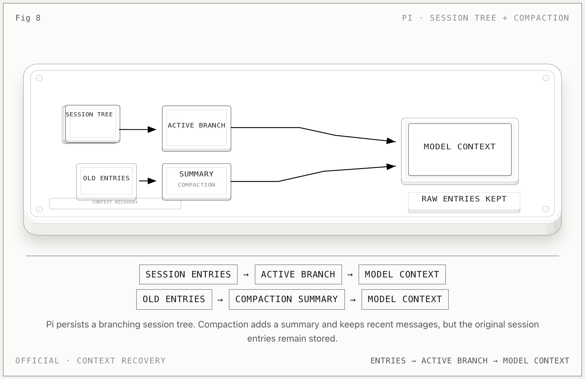

# Pi Memory

**一句话：** Pi 的核心不是用户画像，而是按树保存的 session；模型只读取当前 active branch，compaction 用摘要替换旧上下文，但不会删除原始 entries。

## 记忆怎么流动

1. Pi 把对话保存成 session，entries 通过 `parentId` 组成树。
2. 下一次模型请求只读取当前 active branch，而不是 session 文件里的所有分支。
3. 返回旧节点不会抹掉离开的分支；`/tree` 可以切换分支。
4. 上下文接近上限时，compaction 生成 summary，并保留最近一段消息。
5. 随后重建模型上下文：summary + `firstKeptEntryId` 之后的消息。

## 关键边界

- **raw session history ≠ model-visible context**。
- compaction 改变模型当前看到的上下文，不删除原始 session entries。
- branch summary 是“离开分支的上下文胶囊”，不是用户长期事实。
- 要把 Pi 内容变成用户记忆，必须另做明确抽取，不能让 compaction 自动升级为 profile。

## 官方依据

- [Pi Sessions and Context](https://pi.dev/docs/latest/sessions)
- [Pi Compaction Reference](https://pi.dev/docs/latest/compaction)
- [Pi Session File Format](https://pi.dev/docs/latest/session-format)

[返回总览](../../agent-memory-structures.md)
