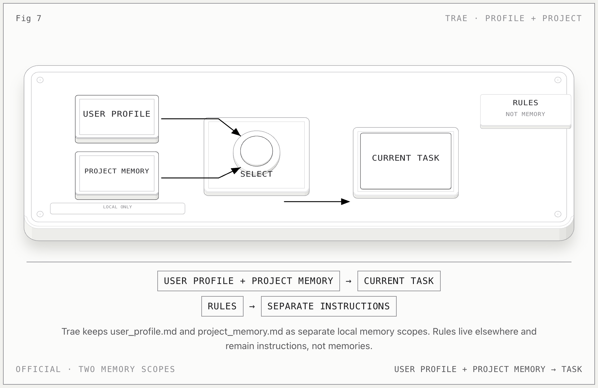

# Trae Memory

**一句话：** Trae 把长期记忆拆成两个本地文件：全局 `user_profile.md` 和项目级 `project_memory.md`；Rules 是另一套 instruction。

## 记忆怎么流动

1. Global memory 应用于当前用户的所有本地项目，保存在 `~/.trae/memory/user_profile.md`。
2. Project memory 只作用于当前项目，保存在 `~/.trae/memory/projects/{project_path}/project_memory.md`。
3. 用户可以直接编辑文件，也可以让 AI 根据对话自动创建、更新或删除记忆。
4. AI 也可以响应用户明确请求，写入、更新或删除某条记忆。

## 关键边界

- memory 数据只存本地，不跨设备共享。
- 一次性指令、模糊偏好和密码等敏感信息不会自动保存。
- Rules（全局/项目规则）是 instruction；不要和两个 memory 文件混写。
- `user_profile.md` 与 `project_memory.md` 必须保留不同 `scope`。

## 官方依据

- [Trae Memories](https://docs.trae.ai/ide/memories)
- [Trae Rules](https://docs.trae.ai/ide/rules)

[返回总览](../../agent-memory-structures.md)
