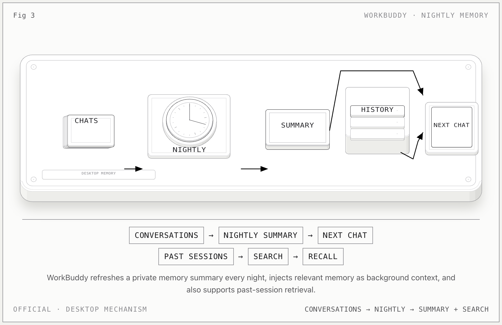

# WorkBuddy Desktop Memory

**一句话：** WorkBuddy 每晚从会话历史中整理记忆摘要，后续把相关记忆作为背景上下文注入，同时保留对历史会话的检索。

## 记忆怎么流动

1. 系统从会话内容中提取事实信息、偏好习惯、人物关系和跟进事项。
2. 每晚重新整理当天的会话，生成或更新“记忆摘要”。
3. 新任务开始时，与当前请求相关的记忆进入系统提示词，作为背景信息。
4. 除记忆摘要外，WorkBuddy 还可以检索过去的会话，回答“上周做过什么”这类问题。

## 关键边界

- **夜间摘要是 memory；“搜索过去会话”是 retrieval**。前者是抽取后的状态，后者仍指向原始历史。
- 用户可以在“设置 → 记忆”里查看、编辑、删除、关闭，也可以从其他 AI 导入使用习惯。
- 官方明确提示概括偏差与时效性问题；重要判断不能只依赖记忆。
- 这里只描述 **WorkBuddy desktop**，不包含另一个 CLI 产品的 Auto Memory。

## 官方依据

- [WorkBuddy 记忆](https://www.workbuddy.cn/docs/workbuddy/From-Beginner-to-Expert-Guide/Function-Description/Memory)

[返回总览](../../agent-memory-structures.md)
